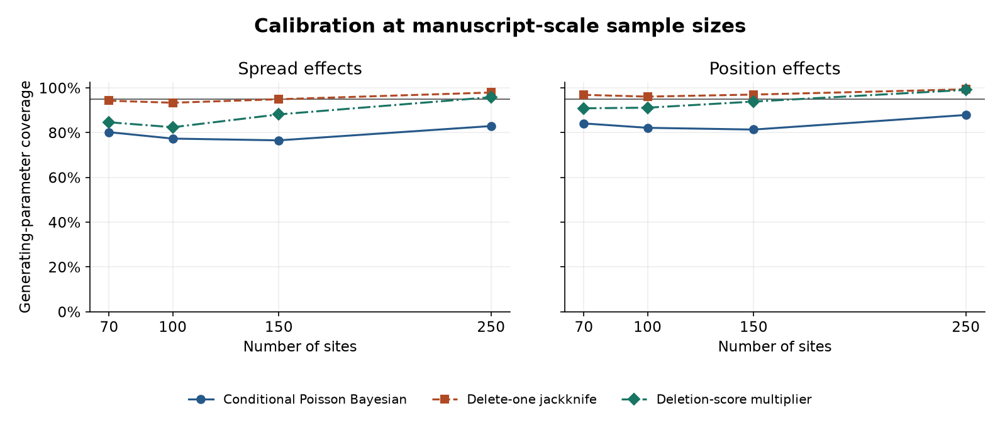
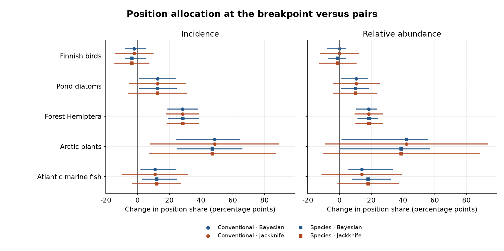

# Manuscript-scale validation of multisite GDUM inference

This analysis evaluates the site counts, orders, and ecological contrasts in the five-community DD2 manuscript analysis. It compares the existing uncertainty estimators and samplers. Package defaults are those of the preceding development commit.

Delete-one calibration was closest to nominal under independent sites, while direct Bayesian intervals were narrower and more often excluded true zeros. In the five empirical communities, the increase in position's share of explained deviance survives both samplers and estimators for Forest Hemiptera in both responses and for Arctic plants in incidence. For Atlantic marine fish, the relative-abundance increase survives the jackknife on the 50,000-set refit, with an inconclusive interval at 10,000. Species contributing to similarity consistently had higher occupancy than species contributing to dissimilarity. Increasing the set budget sharply reduced numerical error in paired contrasts, while site uncertainty remained.

## Analysis targets and data

The empirical roster and orders were checked against the five archived `letter_dd2` metadata tables generated by `paper_mee/letter_analysis.R` and its DD2 loader. Earlier manuscript drafts used a different case-study roster. Each DD2 composition, environment, and coordinate input was checked for alignment and for the expected dimensions after filtering. Environmental transformations follow the DD2 archive. The Finnish coordinate table has sequential rows and is explicitly aligned to the original route order. [Machine-readable roster](manuscript_validation/communities.csv) · [DD2 published data deposit](https://doi.org/10.5281/zenodo.6406911)

| DD2 community | Sites | Species | Orders | Largest $k/n$ |
| --- | ---: | ---: | --- | ---: |
| Finnish birds | 241 | 182 | 2, 15, 28 | .116 |
| Pond diatoms | 102 | 283 | 2, 8, 15 | .147 |
| Forest Hemiptera | 147 | 307 | 2, 6, 11 | .075 |
| Arctic plants | 72 | 54 | 2, 4, 7 | .097 |
| Atlantic marine fish | 202 | 351 | 2, 8, 14 | .069 |

Incidence is total dissimilarity (one minus shared richness divided by mean site richness). Relative-abundance dissimilarity uses within-site proportions and the summed species minima. Both responses use working weight one. Both use the same sets, omissions, spline basis and site weights within each comparison. Conventional sampling and the species-informed mixture ($\alpha=.5$) target the same uniform set distribution. Direct bootstrap draws target the same product-of-site-weights distribution and any species-proposal weights correct back to it. Zero-sharing sets remain in the fits. Pairs were enumerated when they fit within the budget, with exact product weighting for Bayesian site draws on enumerated pairs.

The empirical models constrain directional coefficients to be nonnegative, as in the original analysis. Spread contrasts use one tenth of the spline change from the 25th to 75th percentile. Position contrasts move one site's value from the 25th to 75th percentile. These percentiles and the environmental basis remain fixed across orders and omissions. Geographic distance enters the spread term, with a common distance basis across orders. Predictor importance is the package's covariance share. The manuscript's two-block Shapley allocation compares spread (including distance) with position. For example, the position allocation is $(D^2_{\rm position}+D^2_{\rm full}-D^2_{\rm spread})/2$. The position share divides that value by $D^2_{\rm full}$. This distinguishes an increasing share from an increasing absolute contribution to explained deviance.

## Uncertainty comparisons

### Repeated independent sites

The calibrated response has a known fractional-logit mean and a bounded disturbance contributed by the sites in each set. Two site predictors share a fixed external spline reference. The gradient is null, weak or strong. The control predictor has zero generating effects. The main gradient's position effects are 0, .027 or .090 logit units per reference SD. Spread heights are 0, $.36(1-.5k/n)$ or $1.20(1-.5k/n)$ across the reference spline boundaries. There are 32 independent site samples per size and signal. Fit orders are 2/4/7/14 at 70 sites, 2/5/10/20 at 100, 2/3/8/15/30 at 150 and 2/5/13/25/50 at 250. The extra pair controls at 150 and 250 sites fall below .02 and appear in the detailed tables. A supplementary weak-signal run at 100 sites introduces exponential spatial residual covariance with range parameter .24 on the unit square, as in Phase 2, with 24 replications. That run tests sensitivity to dependence, under which the row-wise resampling methods have different assumptions from the generator.

All calibration fits use 10,000 sets, or exhaustive pairs when feasible. The three interval methods share the same point estimator. One uses 79 direct conditional-Poisson Bayesian site draws and central percentile bounds. The second fully refits after every site deletion and uses a centred, delete-one $t$ interval. The third uses the Phase 2 deletion-score linearisation and 399 Gaussian site multipliers. All methods pair the same site draws or omitted sites across orders. In the simulations, directional coefficients are unrestricted so that zero is a regular point for coefficient-wise false-positive and power calculations. Power requires an interval entirely on the true side of zero. The reported false-positive rate is the fraction of available intervals excluding a true zero. Empirical directional boundaries are handled separately.

For performance, the validation script draws conditional-Poisson sets using the exact existing product-weight target through suffix elementary-symmetric sums. With $r$ places still to fill, the inclusion probability for site $i$ is $\omega_i e_{r-1}(\omega_{i+1:n})/e_r(\omega_{i:n})$. The inverse-tail path uses the corresponding ratio of suffix masses. This is an evaluation helper for sampling from the same law as the package's conditional-Poisson rejection sampler. The unconstrained fit helper solves the same unit-weight logit score equations as the package. The script checks small-set sampling against exhaustive probabilities and checks agreement of full and warm-started delete-one fitted coefficients. Empirical fits call the package's original solver and conditional-Poisson sampler.

### Empirical contrasts and numerical precision

Empirical intervals use 100 paired Bayesian site draws or all matched site deletions on the 10,000-set reference pool. The regular-score multiplier requires a converged, identified interior fit. Importance and Shapley allocations are nonlinear summaries outside the existing coefficient multiplier. We compare them by refitting in the Bayesian and delete-one analyses. A jackknife interval requires all deletions to give finite estimates. A Bayesian interval requires at least 95 of 100 draws. Bounds are reported on the estimating scale without truncation. A delete-one interval can extend outside the possible range of a constrained statistic, indicating limited suitability as a bounded confidence interval. Empirical intervals are sensitivity checks on the observed communities. They do not themselves establish spatial or constrained-coefficient coverage.

At each sampled order, sampler and budget, eight independent whole-set replicates estimate conditional numerical SD for spread, position, importance, Shapley allocations, shares and their paired differences. Exact enumerations have zero conditional MC SD. The empirical tables record convergence, active constraints, information rank, minimum eigenvalue, condition number, corrected sharing probability and the smallest omission ESS. The MC-to-site uncertainty ratio uses the delete-one SE at 10,000 combinations. That denominator can include residual numerical error, especially when few weighted sets survive a deletion. The 50,000 comparison improves the numerical check while holding the same independent sites fixed.

A parallel descriptive analysis checks the manuscript occupancy and local-abundance representation profiles. Per-species incidence or relative-abundance contributions are aggregated exactly within each set, then proposal-weighted across sets. A trait profile is the trait-weighted sum divided by the corresponding similarity or dissimilarity sum. Occupancy and mean local relative abundance conditional on presence are held fixed at the observed site values, as in the archived analysis. These intervals assess stability conditional on the measured species descriptors. Additional held-out scoring reuses the manuscript's 30 disjoint site splits and common conventional test sets; prediction transformations come exclusively from training sites.

## Coverage, error, power and cost in the manuscript-scale simulations

Each size contributes 768 effect intervals per method and family across the four target orders and the null, weak and strong conditions. The entries below give the fraction containing the generating parameter for **spread / position**. The summary pools two coefficients that are estimated on the same sites and should be read descriptively. All 1,728 point fits, including the extra pair controls, converged with full numerical rank.

| Sites | Conditional Poisson Bayesian | Delete-one jackknife | Deletion-score multiplier |
| ---: | ---: | ---: | ---: |
| 70 | 80.2% / 84.1% | 94.3% / 96.9% | 84.6% / 90.9% |
| 100 | 77.3% / 82.2% | 93.4% / 96.1% | 82.4% / 91.1% |
| 150 | 76.6% / 81.4% | 94.9% / 97.0% | 88.2% / 93.9% |
| 250 | 82.9% / 87.9% | 97.9% / 99.3% | 95.8% / 99.1% |



Across the .02–.20 range, median absolute point errors were .399 spread-height units and .0187 position units. Mean signed errors were −.0023 and +.0020 respectively. The three methods use that same point estimate. The tables report interval midpoint errors separately. Direct Bayesian coverage fell from 84.0% / 89.9% in the two low-order bins through .06n to 69.7% / 73.3% at .20n. At .20n, the corresponding jackknife coverage was 97.8% / 98.8% and multiplier coverage was 89.8% / 93.1%. Omitting sites and retaining adequate set ESS was feasible throughout this narrower order range.

| Method | False positives, spread / position | Weak-signal power, spread / position | Strong-signal power, spread / position | Median interval width, spread / position |
| --- | ---: | ---: | ---: | ---: |
| Conditional Poisson Bayesian | 20.6% / 16.7% | 19.3% / 38.9% | 47.9% / 72.7% | 1.484 / .098 |
| Delete-one jackknife | 4.5% / 2.6% | 7.4% / 21.9% | 17.2% / 60.2% | 2.643 / .149 |
| Deletion-score multiplier | 11.2% / 6.3% | 15.0% / 28.7% | 40.2% / 66.4% | 1.967 / .125 |

False-positive and power denominators are 2,048 true-null intervals and 512 nonzero gradient intervals per signal, method and family. The direct Bayesian ability to detect effects comes alongside elevated null rejection. The jackknife gave wider intervals and lower power, particularly for spread. For the deliberately modest nonzero paired spread changes, coverage was 97.8%, 100% and 99.6% for the Bayesian, jackknife and multiplier methods. Correct-direction detection was 1.8%, 0% and 0.1%; these paired results include the extra small-ratio pair controls where applicable. High change coverage can reflect low power to resolve the changes.

In the separate spatial stress experiment at 100 sites, Bayesian, jackknife and multiplier coverage was 80.7%, 94.8% and 88.0% for spread and 72.9%, 89.6% and 81.2% for position. These results limit transport of the independent-site calibration to spatially structured communities.

Median post-point CPU time per regular two-predictor fit at 70 sites was .799 s for 79 Bayesian draws, .104 s for the jackknife and .002 s for the multiplier. At 250 sites these were 2.319 s, .373 s and .006 s. These are implementation and budget comparisons from the validation helpers. The multiplier is inexpensive in regular fits. The constrained empirical calculations have different predictors and refitting costs, reported below.

## Which ecological conclusions survive?

The position-share contrast is the breakpoint minus order 2. The table shows conventional 10,000-set point estimates and 95% limits. The signs of support were identical with species-informed sampling for every response and estimator. The original archived Bayesian analysis had positive intervals for both responses in Forest Hemiptera, Arctic plants and Atlantic fish. Its pond diatom and Finnish bird intervals included zero. In the new 10,000-set fits the direct Bayesian interval also excludes zero in pond diatoms, where the jackknife comparison remains inconclusive.

| Community | Response | Change | Conditional Poisson Bayesian | Paired delete-one |
| --- | --- | ---: | ---: | ---: |
| Finnish birds | Incidence | −.022 | [−.080, .052] | [−.143, .100] |
| Finnish birds | Relative abundance | .001 | [−.081, .041] | [−.120, .121] |
| Pond diatoms | Incidence | .125 | [.010, .243] | [−.055, .306] |
| Pond diatoms | Relative abundance | .106 | [.008, .181] | [−.042, .254] |
| Forest Hemiptera | Incidence | .283 | [.189, .382] | [.178, .389] |
| Forest Hemiptera | Relative abundance | .184 | [.106, .238] | [.094, .274] |
| Arctic plants | Incidence | .486 | [.245, .645] | [.080, .893] |
| Arctic plants | Relative abundance | .422 | [.012, .560] | [−.091, .935] |
| Atlantic marine fish | Incidence | .109 | [.019, .245] | [−.097, .316] |
| Atlantic marine fish | Relative abundance | .141 | [.057, .337] | [−.113, .395] |



The increase is robust to the evaluated estimators and samplers for Forest Hemiptera in both responses and Arctic plants in incidence. The broader cross-community claim depends on the uncertainty estimator. In Forest Hemiptera the absolute spread allocation decreases in both responses, while the absolute position allocation changes little and both interval methods include zero. A higher position share can arise from the declining spread component. Finnish birds show no clear share change and show lower absolute spread and position allocations in both responses under both interval methods. The fit comparisons are paired and intervals are pointwise.

Independent 50,000-set jackknife refits targeted the cases where the 10,000-set methods disagreed. The diatom and Arctic conclusions were unchanged. For Atlantic marine fish, the relative-abundance change became positive under both proposals. Its 95% interval was [.021, .374] conventionally and [.038, .337] with targeted sampling. The incidence intervals still included zero. The change in the fish result is consistent with the narrower site-deletion SEs at 50,000 and exact enumeration of the pair reference at that budget. The finding is best stated for relative abundance with the denser numerical check.

| Community | Response | Conventional 50,000 change [95% interval] | Species-informed 50,000 change [95% interval] |
| --- | --- | ---: | ---: |
| Pond diatoms | Incidence | .125 [−.051, .300] | .127 [−.040, .294] |
| Pond diatoms | Relative abundance | .103 [−.022, .229] | .107 [−.017, .231] |
| Arctic plants | Incidence | .489 [.092, .887] | .485 [.082, .888] |
| Arctic plants | Relative abundance | .442 [−.033, .918] | .444 [−.041, .929] |
| Atlantic marine fish | Incidence | .128 [−.015, .271] | .125 [−.013, .264] |
| Atlantic marine fish | Relative abundance | .198 [.021, .374] | .187 [.038, .337] |

At the point estimates the leading predictor importance agreed between samplers in 29 of 30 community–response–order combinations. Of the breakpoint-minus-pair comparisons across both samplers and responses, direct Bayesian intervals excluded zero in 31/124 spread effects, 39/124 position effects, 35/144 predictor importance changes and 24/40 Shapley allocation changes. The matched jackknife counts were 4/124, 21/124, 18/144 and 18/40. These counts describe interval sensitivity and are not adjusted discovery rates. All 744 fixed-scale predictor contrasts in the 10,000 and 50,000 point-design audit passed the manuscript's marginal support check. The audit does not certify joint support or calibration at a directional boundary.

The species-representation result was consistent across methods. Similarity contributions had higher occupancy than dissimilarity contributions in all 60 community–response–order–sampler comparisons under each estimator. Similarity-weighted occupancy also rose from pairs to the midpoint and breakpoint in all 40 such changes under each estimator. Relative-abundance weighting increased similarity-weighted occupancy in 38 of 60 paired response comparisons pooled across both interval methods, and none gave a clear decrease. This is evidence for the order profile and the similarity–dissimilarity contrast, with a more context-dependent effect of abundance weighting. It is conditional on the measured traits. The separate within-site abundance shuffle was outside the uncertainty-estimator comparison.

At the breakpoints, the median gain from adding position to held-out prediction ranged from −.00135 to +.00070 in response-scale RMSE across the community–response–sampler cells. This auxiliary check offers little support for a broad prediction advantage at the breakpoint. The fit allocation and held-out prediction address different questions.

## Numerical precision and fit diagnostics

All 764 recounted empirical fits across the two numerical budgets converged and had full numerical rank. All 60 primary 10,000-set fits had at least six active directional coefficients, so none was eligible for the existing deletion-score multiplier on the constrained fit. The empirical comparison therefore reports the Bayesian and matched delete-one intervals as refitted. Switching to an unconstrained model solely to compute a multiplier interval would change the target of this comparison.

At 10,000 sets at the breakpoints, base sharing ranged from around .062 in Atlantic fish to .822 in Arctic plants. The fish mixture raised proposal sharing from .062 to .538, with corrected base sharing .064. Its omission ESS fell from 9,245 to 4,835. At 50,000 the lowest fish mixture omission ESS in the point fits was 24,440. Finnish birds had approximately $2.0	imes10^9$ raw condition number in the conventional incidence point fit at order 28 and 10,000 combinations. The condition number remained about $2.3	imes10^9$ at 50,000. High convergence and rank did not remove column collinearity. Raw condition numbers depend on the column scales, including the sum-position design.

The entries below are median conditional MC SD divided by the 10,000-set jackknife SE, pooled across both samplers, responses and communities. Paired changes include adjacent and breakpoint-minus-pair comparisons. Exact pair fits contribute zero conditional MC SD.

| Effect | Single order 10,000 | Single order 50,000 | Paired change 10,000 | Paired change 50,000 |
| --- | ---: | ---: | ---: | ---: |
| Spread | .119 | .029 | .132 | .052 |
| Position | .117 | .041 | .182 | .069 |
| Predictor importance | .104 | .035 | .140 | .059 |
| Shapley allocation | .104 | .033 | .161 | .057 |

Using 20% only as a precision diagnostic, 384 of 1,260 paired comparisons with finite ratios exceeded it at 10,000 draws and 5 exceeded it at 50,000. The fish relative-abundance position-share change had conditional MC SD .0299 conventionally and .0101 with the mixture at 10,000, decreasing to .0118 and .0045 at 50,000. This is a useful case for targeted sampling. It also illustrates why gains in numerical precision do not imply narrower ecological intervals. The eight independent numerical replicates per pool give imprecise term-specific SDs. At a pair enumeration the conditional MC SD is known to be zero.

Median elapsed time over the empirical sampler–order cells was 33 seconds for all deletions and 39 seconds for 100 direct Bayesian draws on this host. Those timings include both responses and the three fits per response, among concurrently running case studies. The calibration table separately reports CPU timing for the regular methods.

## Inference recommendation

Use matched delete-one intervals as the main sensitivity check for the manuscript's order and response contrasts. They provided the closest independent-site coverage and the lowest false-positive rates in this range, at the cost of substantially wider spread intervals. Report direct Bayesian intervals alongside them for continuity with the existing analysis. Give highest confidence to claims that survive both interval methods, both proposals and an adequate MC check. In practice, 50,000 sets are preferable for the final paired effects when 10,000-set MC error is material. The number of sites still controls ecological information.

The deletion-score multiplier is a useful inexpensive screening calculation for regular fits, especially at the largest simulated size. Its spread intervals undercovered at 70–150 sites, and the existing multiplier was unavailable for the empirical monotone fits. Collinearity, active constraints, and spatial dependence limit confirmatory inference even with many sampled combinations. Empirical intervals are conditional on the observed study design. Spatially valid inference for dependent sites and uniformly calibrated coefficient inference at the constraint boundary remain unresolved. Retain the existing bootstrap default. The results support a manuscript-specific paired jackknife sensitivity analysis rather than a general replacement.

The source-package `R CMD check` completed with zero errors, warnings, or notes, with 294 expectations passing and the existing CRAN-guarded optional comparison skipped. The change set contains study scripts, results and documentation.

## Reproduction

Install the development package, set `DD2_DATA` to the directory containing the archived DD2 input matrices, and run from the repository root. Raw data are read in place. The checked-in [results](manuscript_validation/results/) contain the numerical review tables, including individual empirical effects, availability and paired intervals. The calibration accelerators require Rcpp and a C++ compiler. The summariser requires Python and Matplotlib.

```sh
R CMD INSTALL .
export DD2_DATA=/path/to/DD2/Data
out=/tmp/zeta-manuscript-validation
for n in 70 100 150 250; do
  for signal in null weak strong; do
    Rscript docs/manuscript_validation/calibrate.R "$out" "$n" "$signal" 32 79 10000
  done
done
Rscript docs/manuscript_validation/calibrate.R "$out" 100 weak 24 79 10000 spatial
for id in N63TBIRD N68PDIAT N49_Forest_Hemiptera_Gossner N78TPLANT S7MFI; do
  Rscript docs/manuscript_validation/empirical.R "$out" "$id" 8 100
  Rscript docs/manuscript_validation/profiles.R "$out" "$id" 100
done
for id in N78TPLANT N68PDIAT S7MFI; do
  Rscript docs/manuscript_validation/refit_primary.R "$out" "$id"
done
Rscript docs/manuscript_validation/support.R "$out"
Rscript docs/manuscript_validation/holdout.R "$out" 30
python3 docs/manuscript_validation/summarise.py "$out" docs/manuscript_validation/results
```

The seeded estimates reproduce apart from ordinary platform-level numerical differences. Timing depends on the host and load. Separate workers should use separate `CALIBRATION_CPP_CACHE` and `PROFILE_CPP_CACHE` directories if overriding their per-session defaults.
