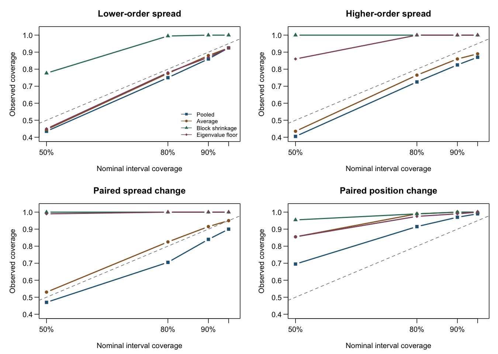

# MS-GDUM adaptive regularisation and uncertainty

This refinement adds component-specific penalties, repeated site-block selection, multisite contextual design diagnostics, global analytical controls and independent-pool covariance estimators to the existing MS-GDUM. It also tests variance and interval calibration with fixed score kernels and controlled regression simulations. The original model and prior interfaces remain the reference for backward compatibility.

## Ecological model and identification

For a set $S$, the model preserves the mean of transformed position values and the mean pairwise directional I-spline differences. It fits a fractional-logit working loss. Curvature, endpoint interaction and ridge penalties enter separately. Fit smoothness by repeating the site partitions with disjoint training and validation sites within a fold. Match set samples across candidate strengths, use warm starts and assess predeclared ecological contrasts as well as prediction error. Disjoint validation sites are the units of held-out comparison. Validation does not apply an independent-observation REML criterion to overlapping combinations. [Wood (2011)](https://doi.org/10.1111/j.1467-9868.2010.00749.x), [Pya & Wood (2015)](https://doi.org/10.1007/s11222-013-9448-7), [Marra & Wood (2011)](https://doi.org/10.1016/j.csda.2011.02.004)

For the derivative penalty, use the Gram matrix $K_{bb'}=\int B'_b(z) B'_{b'}(z)\,dz$. The quadratic form in endpoint coefficient differences measures change in the turnover function per standardised environmental unit. With separate curvature and linear null-space penalties, a curve can be shrunk towards a line, and its retained slope can be shrunk towards zero separately. The penalties define the fitted regression estimand. They do not alter the constraints on the directional curves.

Write $P_b(S)=\operatorname{mean}_{ij}m_{ij}d_{ij,b}$. The proposed contextual column is $C_b=m_SD_b-P_b$. Any design containing both $P_b$ and $C_b$ already spans the set-mean modification $m_SD_b$. The contextual column vanishes at order two. It also vanishes whenever pair differences balance around $m_S$ under the given basis. For symmetric configurations this holds when reflected pairs have equal basis differences. Symmetry of the positions alone is insufficient for a generic nonlinear basis. Weight-adjusted residualisation is a diagnostic of additional design information. Fitting remains in constraint-preserving coordinates. Rank deficiency in endpoint coordinates can coexist with an identifiable combined response or contextual contrast.

## Global score integration

For a fixed score $g_k(S;\theta)$ and site inclusion probability $p_k=k/n$, the uniform-target inclusion estimate is
$$
\widehat G_{ki}=\operatorname{mean}_m[w_m I_i(S_m) g_k(S_m;\theta)]/p_k.
$$
Using raw importance ratios retains the unconditional target. The two study controls subtract the uniform expectations of $I_i$ and $I_iY$ from their weighted sample averages. For relative abundance the latter mean is $p_k U_i(k)$ from exact conditional LCZD. For incidence an exact unnormalised richness analogue supplies the control. Independent pilots estimate the regression coefficients, which remain fixed in production. The same set evaluations contribute to all included sites. Coupled set paths preserve numerical covariance for paired-order contrasts.

For independent centred site score matrices $A_r$ at a common pilot parameter, average the $R$ same-pool covariance matrices or average the $R(R-1)$ ordered distinct cross-products, each over $n-1$. For a pair of pools the cross estimate is the same-pool average minus $(A-B)^T(A-B)/[2(n-1)]$. Under conditionally unbiased, independent numerical integration the distinct cross-products remove the expected numerical contribution. They estimate the covariance of the complete pseudovalues under those assumptions. Finite ecological sampling, higher-order influence, and the fitted pilot parameter can still affect agreement with the desired sampling covariance. Pooling the site scores reduces numerical variance without subtracting it completely. The report includes the pool-to-pool uncertainty and spectrum diagnostics.

Covariance adjustments act in standardised score units. Diagonal shrinkage removes some across-order dependence. A block defined by homologous coefficients retains same-effect dependence across orders while shrinking other associations. PSD projection alters negative directions to zero and may still be singular. Positive eigenvalue floors are explicit sensitivity settings. Report their magnitude and the resulting probability changes. The numerical-pool shrinkage rule targets variability across combination pools and is inspired by, but differs from, ordinary independent-observation covariance shrinkage. [Ledoit & Wolf (2004)](https://www.ledoit.net/Well-conditioned2004.pdf)

## Fixed-kernel benchmark

For iid $X_i\sim N(0,1)$, use two order-specific vector coordinates
$$
h_j(S)=a_j\overline X_S + b_j\,\operatorname{mean}_{i<\ell\in S}X_iX_\ell.
$$
Averaging all sets at any order gives exactly the same sample mean and sample pair-average basis. The complete vector covariance is $aa^T/n+bb^T/\binom n2$. This separates first- and second-order influence analytically. The between-order contrast with equal $a_j$ removes the first-order component even when both marginal effects are dominated by it.

For the equivalent complete pair kernel, let $A,B,C$ average ordered kernel products over edges sharing two, one and zero vertices. The unbiased first and second variance components are $4(B-C)/n$ and $(A-2B+C)/\binom n2$. These are iid, fixed-kernel results. Their estimates can be indefinite in finite samples, and a zero floor would alter unbiasedness. For a pure second-order Gaussian product kernel, the expected delete-one covariance is inflated by $2(n-1)/(n-2)$. This follows from the covariance of the edge sums incident to each vertex and persists with exact set integration. It explains the different behaviour of delete-one inference after first-order cancellation. The fixed-kernel estimator is an explicit comparator and is not applied to fitted nonlinear scores. [Matsushita & Otsu (2021)](https://academic.oup.com/biomet/article/108/3/661/5918019), [Shao, Xia & Zhang (2025)](https://arxiv.org/abs/2306.03793), [Xu, Zhu & Shao (2024)](https://doi.org/10.1214/24-EJS2247)

## Estimating-equation and boundary inference

For averaged stochastic score $G(\theta)$ under constant working weights, a quadratic loss penalty $\theta^TK\theta/2$ defines the estimating equation $G(\theta)-K\theta$. With nonconstant working weights the implementation multiplies the deterministic derivative and curvature by the sum of the effective weights in the score's normalisation, matching the original average working loss. The derivative adds the corresponding deterministic Hessian. Centring the site pseudovalues removes the deterministic term from their covariance.

At the unrestricted target use $Q=nH^T\Omega^{-1}H$. The Gaussian quasi-posterior has covariance $(Q+P)^{-1}$ for a separately specified normal prior of precision $P$. A prior-free Gaussian reference is available. A flat prior is invalid for the nonlinear bounded-score loss and is rejected there. The implementation rejects unidentified model matrices before fitting a penalised score root. A custom named design permits an identified coordinate system chosen by the caller. Any constraints and penalties supplied for that system must use the same coordinates.

Projection of posterior draws uses $Q$ as the metric and the declared nonnegative bounds. It creates a probability mass on constraint faces. The separate tangent-cone calculation projects the unconstrained root in the estimating-equation Hessian metric, and projects zero-mean sandwich increments onto the specified tangent cone. It forms frequentist basic intervals from those increments. A plug-in face and a known generating face are reported separately in simulation. A local cone with a plug-in face can particularly misrepresent effects near the boundary. Projection is evaluated as an approximation, and no calibrated constrained likelihood posterior is assumed. [Astfalck et al.](https://arxiv.org/abs/1812.05741)

## Numerical validation

The complete derivations and replication scripts are in [context and penalties](adaptive_refinement/CONTEXT_AND_PENALTIES.md) and [global scores and covariance](adaptive_refinement/GLOBAL_SCORES.md). The replicate tables and per-community results are in [results](adaptive_refinement/results).

The contextual geometry study used 70-site examples with orders 2, 6 and 12. The scaled design ranks for an additive, pair-midpoint and contextual sequence were 7, 9 and 9 at order 2. They were 7, 9 and 12 at orders 6 and 12 under the uniform and skewed environmental support examples. Reflection-symmetric configurations gave ranks 4, 5 and 5. The greatest fraction of contextual variation remaining after residualising the main columns was .430 at order 6 and .212 at order 12 for uniform support. It was .308 and .119 for skewed support. A midpoint ramp remained an exact alias. Independent quadrature verified the derivative and slope penalty matrices over ranges of widths one, three and seven with maximum difference $3.6\times10^{-15}$. These are design results and do not establish ecological importance of the new directions.

A separate simulation with 112 ecological datasets spanning seven scenarios and 70–250 sites fitted the model sequence at informative orders. It reports known conditional response and contextual effects, grouped by scenario and order. The repeated block selection test used eight ecological replicates in each of four scenarios. In the positive interaction case the selected penalty agreed with the independently best contrast penalty in 25% of samples. The average agreement across leave-one-block-out choices was 1.625 of five partitions. In the linear case these values were 62.5% and 2.375. The available site blocks do not reliably identify a universal penalty strength. [Ecological simulation and selection tables](adaptive_refinement/results/ecology_context_summary.csv)

All five manuscript communities were refitted with occurrence and relative-abundance responses at their previously studied order pairs. The study contains 100 fitted combinations of community, response, order and model, of which 97 converged. The maximum absolute contextual joint response contrast among the 20 D fits was .00986, in Forest Hemiptera occurrence at order six. The median higher-order residual context fraction across communities ranged from .049 to .185. Small fitted contrasts and limited conditional design support together limit a separate interaction interpretation. The empirical results do not establish a new ecological mechanism. The archived files record training-site bases, site-block selections, convergence, held-out assessment and local retention summaries without site coordinates. [Empirical fit table](adaptive_refinement/results/ecology_empirical_summary.csv)

The independent global-score experiment compared control variates at matched CPU cost. In the 70-site relative-abundance case, response controls reduced standardised cross-order covariance error from .045 to .033. Paired site-score precision did not improve consistently. The four-pool cross covariance gave paired variance ratio .992 relative to a much larger fixed-community integration reference, compared with 1.147 for pooled scores in that example. [Score validation table](adaptive_refinement/results/score_summary.csv)

The known-covariance simulation used 240 independent site samples for each combination of 70, 150 and 250 sites and ordinary or cancelling first-order effects. Under first-order cancellation at 70 sites, the cross-pool variance median was 1.092 times its true value for a paired spread contrast, compared with 8.415 for the pooled covariance. Raw cross covariance was indefinite in 95.0% of those replicates, 81.7% at 150 sites and 73.8% at 250 sites. At 70 sites, PSD projection, block shrinkage, diagonal shrinkage and an explicit eigenvalue floor gave paired variance ratios 1.400, 2.702, 3.581 and 4.729. The automatic covariance rule did not restore reliable paired uncertainty. [Covariance validation table](adaptive_refinement/results/covariance_summary.csv)

At 70 sites with weak effects, 200 independent ecological simulations and three 3,000-set covariance pools gave nominal 95% Gaussian GMM coverage of .925/.885/.945 for lower spread, higher spread and paired spread using pooled covariance. Average within-pool covariance gave .970/.980/1.000. Cross covariance was positive definite in 29 of 200 replicates, so coverage conditional on those 29 cannot judge calibration. Block shrinkage produced nominal 95% coverage of 1.000 for both spread levels and their change. Repeating the weak scenario with 12,000 sets per pool increased the positive-definite cross count to 79 of 200, still inadequate for routine inversion. Similar separate tables cover null, spatial and 150–250-site weak effects. The spatial case has shared site dependence and particularly high paired coverage across the tested covariance choices. [Bayesian calibration at 70 sites](adaptive_refinement/results/bayes_regular_70_weak_summary.csv)

For the projection comparison, 200 independent 70-site simulations each generated exact-null, local-to-boundary and interior spread effects. In the near-boundary case, nominal 95% higher-spread coverage was .930 for projected Gaussian draws, .955 for a tangent cone using the known generating face, and .695 for a tangent cone using the fitted active face. Paired spread coverage was .950, .970 and .895 in the same order. The plug-in active face is unstable near the boundary. The oracle face is a diagnostic unavailable in empirical applications. [Near-boundary calibration table](adaptive_refinement/results/bayes_boundary_70_near_summary.csv)

For a complete pair kernel under first-order cancellation, 1,000 independent 70-site Gaussian ecological samples gave a delete-one paired variance mean 2.040 times the analytical variance. The overlap estimator mean was 1.020 times that variance and yielded negative or zero paired estimates in half the replicates. Using the analytical fixed variance, the nominal 95% interval covered 93.7% of ecological samples. The jackknife covered 85.0% in this benchmark because its random estimated variance was unstable. The exact overlap formula is a diagnostic of higher-order contribution and has not been applied to nonlinear fitted regression scores. The sampled order-8 kernel average was also compared with the complete scalar kernel to record numerical error. [Fixed-kernel table](adaptive_refinement/results/hoeffding_summary.csv)

## Current decision

Retain the original MS-GDUM as the reference fit and report B, C and D as declared sensitivity models. Use separate component penalties and show the ecological contrast along the regularisation path. A contextual coefficient requires a rank and residual-support check. The five community applications currently support reporting combined fitted contrasts and local retention profiles.

Pooled independent scores gave a positive-definite joint covariance in every listed calibration replicate and are the computational reference for experimental GMM. The cross estimate is informative about numerical contamination, and its indefinite spectrum must be reported. PSD and shrinkage choices changed paired uncertainty substantially. No covariance regulariser, JEL formulation or boundary projection in these experiments has demonstrated reliable coverage across levels, paired contrasts, spatial dependence and active constraints. The existing centred pseudovalue bootstrap remains a comparator. Full calibration of the extended nonlinear model is unresolved.

A single 150-site, two-order functional posterior audit used a fixed, identified twelve-coordinate contextual design. The Gaussian pooled posterior assigned probability 1.000 to both increasing nonlinear position amplitude and increasing contextual modification, with probability .966 for a contextual change above .10. Cross-pool covariance had a standardised minimum eigenvalue of −.00242. An explicitly specified .02 eigenvalue floor changed the corresponding probabilities to .674, .622 and .525. Nonlinear integration under that same floored covariance gave .665, .543 and .449. Its minimum effective sample size across coefficients and contrasts was 122, with maximum split $\widehat R$ 1.038. The latter is below the stricter 200-ESS reference criterion, so its tail probabilities are descriptive. The covariance choice dominates these posterior conclusions in this fixed example. [Functional posterior audit](adaptive_refinement/results/functional_posterior.csv)

The highest-order contextual and nonlinear posterior probabilities remain uncalibrated across independent ecological samples. The 200-replicate GMM studies use regular low-dimensional score roots to isolate covariance behaviour. They do not demonstrate calibration of the extended 12-coordinate contextual model. Likewise, the five empirical community refits report sensitivity of fitted ecological components and site retention, rather than posterior interval claims.
