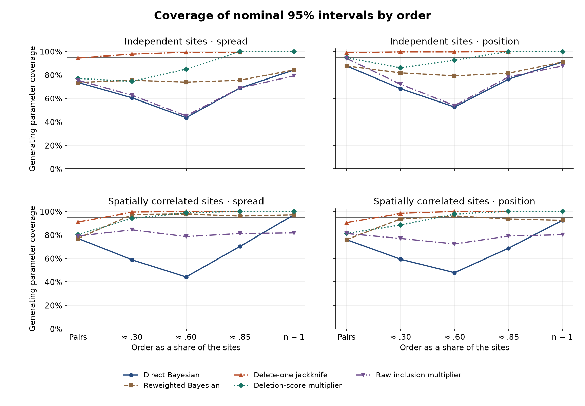
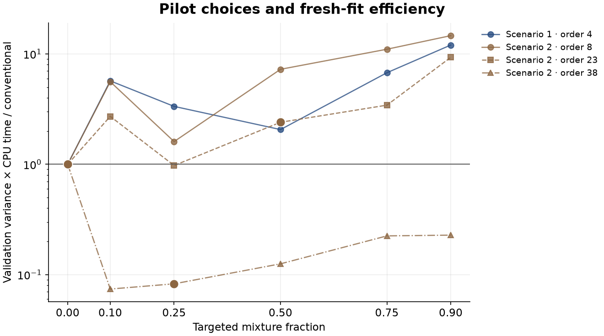
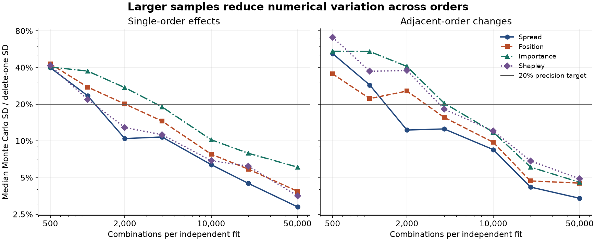
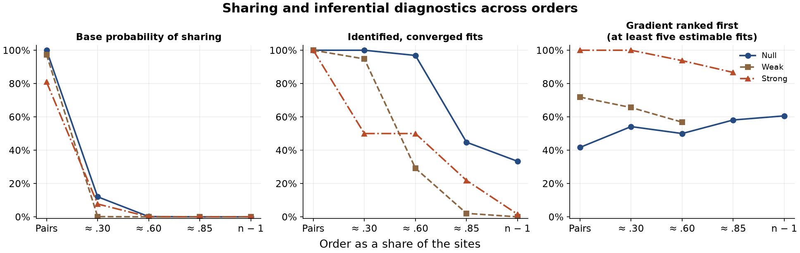

# Phase 2 validation of inference across zeta orders

The [manuscript-scale validation](MANUSCRIPT_SCALE_VALIDATION.md) follows this
work at 70–250 sites and covers the five manuscript DD2 communities.

This study separates numerical set-sampling error, variation across independent samples of sites, and loss of parameter information. Explained deviance and held-out prediction are reported as secondary outcomes. The original ecological retention breakpoint and legacy automatic order selection remain available. Pairs were consistently estimable in the tested ecological communities. By about .60n, only 29% of weak-signal and 50% of strong-signal ecological fits were identified and converged with a nonconstant response. Known-parameter calibration also depended on the effect and interval method, even at pairs. The evidence supports effect-specific diagnostic profiles and a separate numerical budget decision. A universal maximum informative order remains unsupported.

## Targets, simulation design, and common scales

- **Set Monte Carlo uncertainty.** Hold a community and its predictor basis fixed and repeat whole set draws with independent seeds. The variation is conditional on the sites. Where enumeration is feasible, use the exhaustive finite-community fit as a separate reference.
- **Ecological sampling uncertainty.** Independently regenerate the sites, environmental values, abundances and latent disturbances. Compare interval coverage to known coefficients using a bounded set response with exactly specified conditional mean. Run separate simulations of actual community dissimilarity, where the population GDUM coefficients are generally unknown. These give rank, fit, prediction and across-community variability diagnostics.
- **Parameter information.** Record the rank, smallest eigenvalue, and condition number of the weighted fitted information matrix, optimiser convergence, active monotonicity constraints, and the effective size left after each site deletion. Rank is a numerical diagnostic. Full rank alone does not guarantee precise or identifiable effects in a practical sense.

By the law of total variance, variation of an estimator across repeated site samples has one component from its conditional mean across sites and another from the expected conditional set-sampling variance. The repeated set draws estimate the latter for one community. The deletion and independent-community experiments probe the former. A coefficient can remain unstable after the set-sampling component has become small.

The coverage experiment uses eight configurations crossing selected combinations of 18, 36, or 72 sites, broad, narrow, or spatially patchy communities, null, weak or strong environmental signal, and independent or spatially dependent site disturbances. Prescribed occupancy distributions were beta(6, 2), beta(2, 5), and beta(1.2, 3.2). Niche widths were 1.45, 0.48, and 0.70, with local range windows in the patchy configuration. Known-model spread effects and community niche strength varied by signal. The known-model spread effect for the main gradient declines with $k/n$, while position effects are constant across orders. This is a selected scenario grid. The main grid estimates the joint effects of changes in occupancy, breadth, sample size, and dependence.

All within-community comparisons use the same basis across orders and on each site deletion. Known-parameter experiments fix the common environmental basis externally, so independent communities have the same numerical truth. Position coefficients are per one reference site SD in the summed predictor. Spread heights are link contrasts across the common spline bounds. Both are coefficient-scale summaries. A fixed-scale contrast can still be poorly supported by the sets at a particular order.

Held-out validation estimates environmental means, SDs, and spline bounds from the training sites, including training sites that happen to be absent from the set draw. It applies that reference unchanged on test sites. Spread values outside the training range use the nearest boundary, and position values use training centring and scaling with no clipping. Existing calls to `ugdm_design()` default to building the basis from all rows supplied to that design. Older reference objects retain their distance-reference behaviour.

## Inference methods

Let $g(S;\theta)=x(S)[y(S)-\mu(S;\theta)]$. The normalised fitting weights combine the response working weight with the proposal correction. Let $F$ be the mean score under these weights, $I_i$ the weighted sum of scores in sets containing site $i$, and $p_i$ the total fitting-weight mass of those sets. Then the exact score under deletion, evaluated at the full-sample solution, satisfies

```math
F_{-i}-F=-\frac{I_i-p_iF}{1-p_i}.
```

The full delete-one jackknife reoptimises the model on sets that omit each site. Its variance is $(n-1)/n$ times the sum of squared deviations of the deletion estimates from their mean. The regular site multiplier instead linearises the deletion at the full-sample Hessian $H$, maps to the requested effect, and centres the site pseudovalues $(n-1)H^{-1}(I_i-p_iF)/(1-p_i)$. Independent standard normal multipliers applied to the centred pseudovalues use denominator $\sqrt{n(n-1)}$. Their conditional covariance is the sample covariance of the pseudovalues divided by $n$. The raw inclusion-score comparator uses $n H^{-1}(I_i-p_iF)$ without the omission adjustment.

For complete uniformly weighted sets with equal working weights, $p_i=k/n$. The ratio of linearised deletion pseudovalues to raw inclusion scores is exactly $(n-1)/(n-k)$. For an additive kernel this recovers the sample-mean influence exactly. For a nonlinear fitted model the deletion Hessians can differ, especially near $k=n$. The factor corrects the omission algebra. Interval calibration remains an empirical question for each data-generating regime. The multiplier is withheld for an active directional constraint, an unidentified or unconverged fit, or a site with no effective excluded sets. The theory motivating site projections concerns independent sites and a nondegenerate first projection. It does not validate the large-$k/n$ or dependent-site settings explored here. [Arvesen, jackknifing U-statistics](https://statistics.stanford.edu/technical-reports/jackknifing-u-statistics), [Chen and Kato, jackknife multiplier bootstrap](https://experts.illinois.edu/en/publications/jackknife-multiplier-bootstrap-finite-sample-approximations-to-th/)

The product Bayesian bootstrap integrates the same product-weight target over all enumerated sets, or reweights a fixed Monte Carlo sample. The direct implementation draws fresh conditional-Poisson sets for each site-weight vector when enumeration is unavailable. A weighted pool of sampled sets can have additional weight concentration. Both use the same paired site weights across orders. We use 39 Bayesian draws, 399 Gaussian multiplier draws and complete site deletions. Percentile intervals for the two Bayesian and multiplier procedures are compared with centred jackknife $t_{n-1}$ intervals. Synthetic coverage uses unrestricted directional coefficients, including zero in the unrestricted parameter space. Its goal is regular-parameter coverage, separate from monotone inference.

For monotone model testing, the exchangeable iid synthetic null permits site-label randomisation of the entire environmental row. Each of 39 permutations refits the constrained model on the same environmental-label-independent set pool. The test statistic is full model deviance reduction, and the Monte Carlo permutation p-value counts ties and includes the observed fit. This tests a global environmental null. Its permutation reference addresses the joint boundary problem. Coefficient-wise constrained coverage remains open. Spatial dependence breaks the unrestricted exchangeability used here, so the test is evaluated only in iid scenarios. [Self and Liang, boundary likelihood asymptotics](https://doi.org/10.1080/01621459.1987.10478472)

## Independent pilot and adaptive set budgets

The sampler evaluates targeted fractions 0, .10, .25, .50, .75, and .90. A pilot uses 10 independent 1,000-set fits per fraction. It minimises the trace of the sampling covariance of common-scale spread and position effects times the median CPU time per fit. This approximates precision per unit of computation when variance is inversely proportional to draws and per-draw cost is stable. Failed, constant-response, or rank-deficient pilots cannot win solely by reporting small variance. Confirmation uses independent draws. The proposal still has its analytical base-to-mixture weight for the selected fraction. Use `zeta_orders(sampling = "species", alpha = "adaptive")` for paired fits with a separate pilot at each order. A numeric vector named by order reuses prespecified fractions and keeps the paired site weights. Evaluation uses 12 new 4,000-set fits per fraction. Bias and nonlinear instability can still affect the cost score.

The budget study uses 500, 1,000, 2,000, 4,000, 10,000, 20,000, and 50,000 combinations, with eight independent fits at each budget. It estimates conditional Monte Carlo SD for spread, position, importance, Shapley values, and adjacent-order changes. For the ecological reference, exclude each site from the same independent 50,000-set pool, or enumerate when there are at most 30,000 possible sets. Deletion SDs estimated from an incomplete pool can contain Monte Carlo error, especially when few weighted sets exclude a site. The code reports their minimum exclusion ESS. Adjacent-order contrasts match the deleted site across orders.

The demonstration uses an explicit numerical tolerance of Monte Carlo SD at most 20% of the ecological SD, for every assessed effect and contrast. The first passing budget must also pass on a fresh batch of fits. Undefined effects, unidentified fits, and unavailable ecological scales cannot confirm. `stop_after_confirmation = TRUE` skips larger budgets in production, while the default returns the full diagnostic curves. Users can declare which effects need precision before fitting. The tolerance controls numerical uncertainty for those effects. More sets do not add independent ecological observations.

## Additive benchmark isolates loss of bootstrap variation

For 500 independent samples of 18 standard-normal sites, let the value of a set be the mean of its site values. At every order the exhaustive set mean is the ordinary site mean, with true sampling SD 0.2357. At order 17 the omitted site's probability under product weights is proportional to the reciprocal of its site weight. At order 18 all draws use the same set, so product weighting changes no estimate.

| Order | Median Bayesian SD | Bayesian 95% coverage | Median jackknife SD | Jackknife 95% coverage |
| ---: | ---: | ---: | ---: | ---: |
| 2 | .1995 | 85.4% | .2340 | 94.4% |
| 17 | .0270 | 16.2% | .2340 | 94.4% |
| 18 | .0000 | 0.0% | Unavailable | Unavailable |

This isolates the effect of overlap because the estimand and its ecological sampling variance stay constant. The full model experiments below assess how well the same deletion logic works with multiple, nonlinear coefficients.

## Known-parameter coverage, bias, and boundary-aware testing

The calibration study used 32 independently generated communities per configuration, with five orders per community. The table pools the two coefficients within each effect family. This gives 320 comparisons per iid cell and 192 per spatial cell. The denominators in the review tables distinguish available intervals from attempts. Values below are **spread / position** coverage of nominal 95% intervals.

| Sites | Order region | Direct Bayesian | Reweighted Bayesian | Delete-one jackknife | Raw inclusion | Deletion-score multiplier |
| --- | --- | ---: | ---: | ---: | ---: | ---: |
| Independent | Pairs | 73.8% / 87.8% | 73.8% / 87.8% | 94.7% / 99.1% | 75.6% / 94.4% | 77.2% / 95.0% |
| Independent | About .30n | 60.6% / 68.4% | 75.6% / 81.9% | 97.8% / 99.7% | 62.8% / 72.2% | 74.7% / 86.3% |
| Independent | About .60n | 43.8% / 52.8% | 74.1% / 79.4% | 99.4% / 99.7% | 45.3% / 54.1% | 85.0% / 92.8% |
| Independent | About .85n | 69.1% / 76.6% | 75.6% / 81.6% | 99.4% / 100% | 69.1% / 78.4% | 100% / 100% |
| Independent | n − 1 | 84.4% / 91.3% | 84.4% / 91.3% | Unavailable | 79.4% / 87.8% | 100% / 100% |
| Spatially correlated | About .60n | 44.3% / 47.9% | 97.9% / 96.4% | 100% / 100% | 78.6% / 72.4% | 99.0% / 97.9% |
| Spatially correlated | n − 1 | 97.3% / 92.6% | 97.3% / 92.6% | Unavailable | 81.8% / 80.2% | 100% / 100% |



Both Bayesian approaches undercovered iid spread effects across these orders. The omission adjustment brought the iid multiplier closer to nominal near .60n, but its median iid spread interval width rose from 3.95 at pairs to 30.0 near .85n and 162 at n − 1. The jackknife median iid spread widths were 10.7 at pairs and 25.7 near .85n. Coverage near one at higher orders therefore often reflected very wide intervals. At n − 1, the spatial Bayesian estimates used 188 of 192 intervals per family. The reported spatial coverages are specific to the chosen dependence and signals. The same procedures can have poor spatial coverage at other orders. For spatial pairs, for example, jackknife spread and position coverage was 91.1% and 90.6%.

For iid sites, mean signed spread-height bias was +.381 at pairs and +.585 near .60n, with median absolute errors of 1.22 and 1.74 respectively. Position median absolute errors were .153 and .032. Different effects can gain and lose precision at the same order. All synthetic point fits were numerically full rank and converged, yet at 36 sites the median condition number rose from 4,827 at pairs to about 409 million at n − 1. Every fitted monotone model in this experiment had at least one active direction constraint. This is why convergence and rank should be read alongside parameter information and calibration.

Exact finite-community comparisons answer a different question. Relative to the exhaustive fit on the very same sites, six independent 500-set fits per eligible cell had median absolute spread errors of .123 at pairs, .353 near .85n in the exhaustively enumerable cells, and .238 at n − 1. The corresponding position errors were .0268, .0080 and .0029. The pair comparison includes exactly enumerated pairs when the 500-set budget covered them. The finite-reference errors are conditional set-sampling errors. For example, iid median spread error against the generating parameters was 1.91 at n − 1 despite the much closer finite-community approximation.

For the known nonzero iid main-gradient spread change from pairs to about .30n, the direct Bayesian interval covered 84 of 96 generating changes and excluded zero in 13 of 96. The deletion-score interval covered 92 of 96 and excluded zero in 4 of 96. The delete-one interval covered all 96 and excluded zero in none. From about .60n to .85n all five methods covered the 96 iid generating changes, and none excluded zero. Such intervals offer little ability to resolve the known changes.

The constrained global test at the 5% level produced the following false-positive rates and power under iid sampling. The null column contains two configurations, the weak column two, and the strong column one. Rejection rates pool independent simulated communities.

| Order region | Null rejections | Weak rejections | Strong rejections |
| --- | ---: | ---: | ---: |
| Pairs | 1/64 (1.6%) | 4/64 (6.3%) | 8/32 (25.0%) |
| About .60n | 4/64 (6.3%) | 7/64 (10.9%) | 32/32 (100%) |
| n − 1 | 2/64 (3.1%) | 19/64 (29.7%) | 32/32 (100%) |

In this known-response model the sum-position signal can be detectable even near n − 1. A global rejection provides no interval for an individual spread coefficient or its change. Coefficient accuracy and ecological signal recovery require their own diagnostics.

## Independent validation of adaptive sampling

Six of the nine pilot community–order cells had at least one usable fresh-fit estimate. The pilot recovered the lowest observed fresh-fit cost in two of those six cells, both conventional choices. In the broad 48-site community at order 38, its selected .25 fraction cost 0.083 times the conventional result on fresh fits, while .10 had the lowest observed cost. In that same community at order 23, the selected .50 fraction cost 2.40 times conventional and .25 was the lowest-cost choice. Two other cells had usable selected mixture results while the conventional fresh-fit run was ineligible. Three cells had no usable candidate. These results depend on the chosen effect scales, sampling budgets, community, and solver. The fresh-fit costs exclude the up-front pilot, which matters for single analyses. An independent pilot can identify a useful allocation in some cells. Pilot rankings were unstable across the independent samples.



## Numerical precision and adaptive sample sizes

The table pools the three fixed communities. The ratio columns are medians among effects with estimable Monte Carlo and ecological scales. The pass counts use all requested effects, including results with unavailable scales. Orders at which a control spread effect was exactly zero in the bootstrap reference and all point replicates had a zero-over-zero ratio. These ratios remain unavailable under the default all-effect criterion.

| Sets per fit | Single-order median ratio | Single-order pass count | Adjacent-order median ratio | Adjacent-order pass count |
| ---: | ---: | ---: | ---: | ---: |
| 500 | .410 | 2/72 | .522 | 0/48 |
| 1,000 | .256 | 9/72 | .295 | 2/48 |
| 2,000 | .188 | 19/72 | .346 | 3/48 |
| 4,000 | .136 | 25/72 | .188 | 10/48 |
| 10,000 | .073 | 33/72 | .100 | 15/48 |
| 20,000 | .059 | 36/72 | .057 | 15/48 |
| 50,000 | .038 | 36/72 | .045 | 15/48 |

At 50,000 draws, all 36 single-order effects and 15 adjacent changes with finite ratios passed the numerical tolerance. In the broad 48-site community, the order 23 versus order 8 change passed for all eight effects at 10,000 draws, even though the individual order 23 control spread had no estimable variance ratio. The three retention breakpoints were 4, 14, and 7. The all-effect analysis confirmed no common budget through 50,000 sets in each of the three communities. In the broad community the median information condition number at 50,000 sets rose from about 22,900 at order 8 to 2.25 million at order 38. The raw condition number depends on the units of the columns and is used comparatively under the common design. The broad community illustrates how low conditional Monte Carlo SD can coexist with weak parameter information.



A focused independent broad-niche community predeclared the main gradient's spread, position, importance, and Shapley effects at orders 8 and 23 and their changes. Four thousand sets passed all 12 initial comparisons, but one fresh comparison had an MC-to-ecological SD ratio of .235. At 10,000 sets, all 12 passed both the initial and confirmation batches, with maximum ratios of .112 and .114. Production stopping therefore selected 10,000. This confirms conditional numerical precision for those effects and orders. It leaves ecological coverage as a separate question.

## Ecological simulations and order diagnostics

Across 256 independently generated communities in the eight main scenarios, all pair fits were converged, numerically full rank, and had a nonconstant response. The following table uses actual community total dissimilarity. The rank is the fraction of fits with a defined importance share where the signal gradient outranked the control. A dash denotes fewer than five estimable ranks in the corresponding figure.

| Signal | Order region | Median target sharing | Identified and converged | Main gradient first (valid / attempted) |
| --- | --- | ---: | ---: | ---: |
| Null | Pairs | 100% | 100% | 41.7% (96/96) |
| Null | About .60n | .158% | 96.9% | 50.0% (94/96) |
| Weak | Pairs | 97.4% | 100% | 71.9% (96/96) |
| Weak | About .60n | 0% | 29.2% | 56.8% (44/96) |
| Weak | n − 1 | 0% | 0% | — (0/96) |
| Strong | Pairs | 80.9% | 100% | 100% (64/64) |
| Strong | About .60n | .007% | 50.0% | 93.8% (32/64) |
| Strong | About .85n | 0% | 21.9% | 86.7% (15/64) |
| Strong | n − 1 | 0% | 1.6% | — (1/64) |



High conditional ranking recovery in the strong scenario applies to the shrinking subset with estimable importance. It is separate from the probability that an independent community supports a fit. Among weak-signal communities, the across-community SD of the main gradient position coefficient rose from .118 at pairs to .386 near .3n. This describes variation in estimates from independent communities under the tested designs and includes residual set-sampling error for orders requiring Monte Carlo. It does not supply true GDUM coefficients for the ecological generator. Pair holdout median D² was −.082, −.049, and .113 for null, weak, and strong scenarios. Near .3n it was −.248, −.389, and −.108 respectively, using the first 12 replicates per configuration. D² is especially sensitive to the null deviance near constant dissimilarity.

A separate 16-cell sensitivity grid independently varied 24 versus 60 sites, breadth .48 versus 1.45, sparse versus common occupancy, and independent versus spatial environments, holding the ecological effect strength at the weak setting. With $k/n$ near .9, common-occupancy cells produced converged, full-rank, nonconstant fits in 52.3% of 24-site communities and 40.6% of 60-site communities. Sparse-occupancy cells produced such fits in 1.6% and 0% respectively. Each pooled comparison had 128 independently generated communities. The results support checking occupancy and usable information together. Larger site counts at a comparable $k/n$ did not compensate for sparse sharing in these scenarios.

The target sharing probability is estimated by the importance-weighted indicator of sharing. The raw proposal fraction is shown separately in the diagnostics. The exact expected **number** of shared species comes from the occupancy calculation. This also yields lower and upper bounds on the base probability of sharing, namely the largest species sharing probability and the smaller of one and the expected number. The ecological retention breakpoint is calculated separately. The legacy 4% rule remains for backward compatibility. These results favour presenting order profiles with identification, convergence, boundary status, exclusion ESS, conditional MC precision, and calibration evidence. A fixed replacement cutoff remains unsupported by the study.

## Limitations and interpretation

- The site jackknife and score multiplier target independent-site variation with a fixed predictor reference. A spatial dependence model or a defensible block design is needed for regionally correlated sites. The spatial scenarios here are stress tests for the iid methods.
- At large $k/n$, deletion changes the support markedly. At $k=n-1$ a deletion leaves a single set. The nonlinear GDUM has too many coefficients for this refit, even when the full fit has numerical rank. A first-order score approximation may still return a number there. Its availability is distinct from coverage.
- The known response is a bounded fractional response generated by a GDUM link and site disturbances. Mechanistic incidence responses can be misspecified by that link. The ecological results therefore report ranking and stability, while known-parameter coverage is evaluated in the synthetic experiment.
- The precision rule compares against an estimated ecological scale. Weak identification and noisy deletion fits can inflate that scale. Read it alongside omission ESS and fit diagnostics. The pilot trace weights the declared link-scale effects equally, and the winner depends on which effects and hardware determine the cost.
- The global permutation test preserves the monotone constraint under an exchangeable null. Coefficient-specific constrained inference, joint support of spread contrasts near the top orders, and dependence-robust intervals remain unresolved.
- Larger set budgets can reduce simulation error in model summaries. The amount of ecological information still depends on the sites, their dependence, the set order, and which effects the community supports.

## Reproduction

Install the development package. The R script generates seeded replicate-level CSV files, and the Python script makes review tables and figures from them. The observed timing and a pilot choice near a tie can vary across machines.

```sh
R CMD INSTALL .
Rscript docs/phase2/simulate.R /tmp/zeta-phase2-raw all 32
python3 docs/phase2/summarise.py /tmp/zeta-phase2-raw docs/phase2/results
```

The stages `calibrate`, `precise`, `focused`, `ecological`, `sensitivity`, and `additive` can also be run separately into the same output directory. Reproducing the figures requires Python with Matplotlib. Set `ZETAGDUM_CALIBRATION_SCENARIOS` to comma-separated scenario indices to run independent calibration shards into separate directories. Concatenate the same-named raw CSVs from those directories using one header before summarising. Spatial-only shards produce no permutation file. The checked-in [review tables and figures](phase2/results/) give coverage denominators and diagnostics by order. R 4.6.1 on macOS arm64 was used for the reported runs.

The source-package `R CMD check` completed with zero errors, warnings, or notes. The development suite passed 295 expectations, including its optional installed `gdmmTMB` check. Standard `R CMD check` passed 294 expectations and skipped that optional check under its existing CRAN guard.
