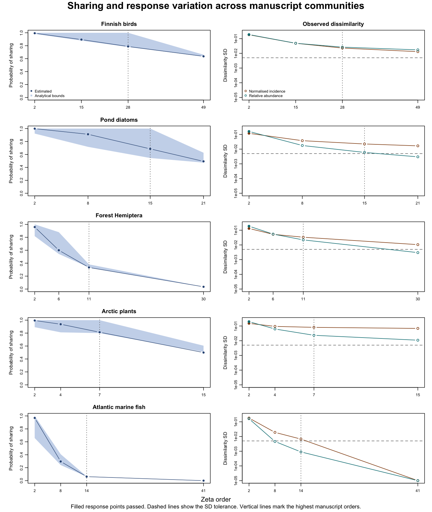
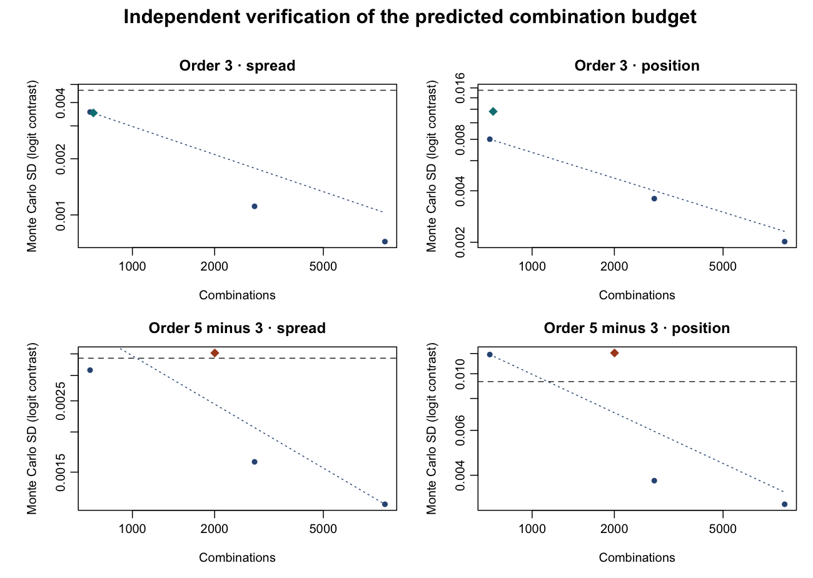

# Phase 4 validation report

## Order and budget decisions

Use separate ecological and numerical checks for each community, response and predeclared environmental contrast. In the five manuscript datasets, appreciable sharing often persisted after the spread and position analyses stopped meeting the precision checks. At the highest manuscript orders, the matched site-deletion evidence did not support a verified budget under the tolerances tested here. That result warrants an uncertainty qualification for those analyses. It does not establish that the environmental effects are absent.

The package provides three new entry points. `zeta_order_support()` describes the exact finite-community sharing process, `sample_sets_stratified()` implements zero/positive-sharing sampling, and `ugdm_order_limits()` fits the existing MS-GDUM over a declared order grid and verifies candidate set budgets. Existing fitting, uncertainty and sampling defaults remain in place.

## A community-specific procedure

1. Declare the MS-GDUM response, working weights, environmental variables, and orders before inspecting the fitted effects. Include order two, the orders relevant to the ecological question, and a realistic upper range. Use denser spacing near consequential transitions. The highest reported order is the largest order tested that passes. A gap in the grid leaves intermediate orders unresolved.
2. Inspect expected shared richness and its variance, bounds on positive sharing, expected shared relative abundance, and effective contributing species. Record the existing incidence retention breakpoint as a property of the zeta curve. Inspect the observed response mean and SD as well. For relative abundance, near-unit dissimilarity can leave virtually no variation despite high retention or high positive sharing.
3. Set a minimum meaningful response SD and a maximum ecological SE for the spread and position contrasts. The spread contrast is 10% of the I-spline difference from a fixed site interquartile span. The position contrast shifts one site's position by the same interquartile span. These are fixed logit-scale model contrasts with the same site standardisation and spline basis at every order and site deletion. The model may include other environmental predictors and geographic distance. Re-run the criteria for additional predeclared focal predictors if the scientific conclusion relies on them.
4. Diagnose joint predictor support and the working Hessian before using coefficients. Examine numerical rank, condition, the smallest correlation eigenvalue of the set design, active coefficient constraints and minimum exclusion effective sample size. Rank can remain full with poorly separated directions. The diagnostics use the actual working weights. A larger combination count increases numerical precision while leaving the ecological sample size unchanged.
5. Run two independent set pools for the matched site jackknife. For each pool, refit after excluding each site by retaining only sets that omit it and hold the environmental basis fixed. Use the same deleted site when subtracting contrasts between orders. Require finite SEs and reproducibility of the centred deletion patterns. If the two pools disagree materially, increase the reference set budget or return ecological precision unresolved. If the jackknife is stable but wider than the predeclared tolerance, increasing the set budget alone cannot certify the ecological contrast.
6. Estimate integration variance from independent fit replicates at two or more pilot budgets. Predict a budget for every required spread, position and paired-order contrast. Confirm at the largest of those budgets using independent replicates. Return the order without a verified budget if the inverse-size relationship is unstable, the budget exceeds the cap, or confirmation fails. The numerical procedure neither tests whether an effect is zero nor selects on explained deviance. Deviance Shapley values and their paired changes are available as supplementary comparisons.

For example, this uses the focal temperature contrasts while fitting every
column in the environmental table. Replace the order grid and tolerances with
those justified for the community and its sampling design.

```r
out <- ugdm_order_limits(
  counts, environment, orders = c(2, 3, 5, 8), predictor = "temperature",
  max_ecological_se = c(spread = .10, position = .35),
  min_response_sd = .005, component = "relative",
  reference_M = 50000, max_budget = 50000, seed = 21
)
out$profile
out$precision
out$retention_break
out$highest_supported_order
```

### Exact sharing diagnostics

For uniform size-$k$ sets let $p_a(k)$ be $\binom{a}{k}/\binom{n}{k}$, set to zero when $a<k$. If $o_s$ is species occupancy and $o_{st}$ pairwise co-occupancy, then

$$
\mu=E[Z_k]=\sum_s p_{o_s}(k),\qquad
m_2=E[Z_k^2]=\mu+2\sum_{s<t}p_{o_{st}}(k),\qquad
\operatorname{Var}(Z_k)=m_2-\mu^2.
$$

The implementation computes one species-by-species co-occupancy cross-product and tabulates the lower-triangle occupancies. Log-binomial ratios are evaluated for occupancies from 0 to $n$. Both operations avoid enumerating sets. Storage is quadratic in the number of species for the cross-product, so very large species pools may need a tiled or sparse method.

Writing $m$ for the number of species with $o_s\ge k$, the lower bound on $\Pr(Z_k>0)$ is the maximum of zero, the largest marginal species probability, $\mu^2/m_2$ by Cauchy–Schwarz, $(3\mu-m_2)/2$ by the first two inclusion–exclusion terms, and $\mu/m$. The upper bound is the minimum of one, $\mu$ by the union bound, and $\mu-(m_2-\mu)/m$. The last follows from $(m+1)z-z^2\ge m$ for integers $1\le z\le m$. Empty support gives probability zero and a ubiquitous species gives probability one. The bounds can be wide when many species co-occur and use double-precision probabilities.

Abundance zeta sums the exact expected species minima of site relative abundances. For either response, divide each expected shared species contribution by their sum, then report the inverse sum of squared shares as the effective number of contributors. This concentration index is undefined at zero total contribution. Retention at order $k$ is the ratio to order $k-1$ even when the diagnostic grid skips $k-1$. A large ratio can occur when both terms are tiny.

### Stratified sampling and weights

Let $H=1(Z_k>0)$ and $\pi_h=P(H=h)$. Draw fixed quotas $M_h$ independently from uniform sets conditional on each stratum. A row receives weight $M\pi_h/M_h$, which keeps both strata in the unconditional uniform-set objective. Exact mass is used when enumeration is feasible, when a species is ubiquitous, or when sharing is impossible. For larger cases the method uses a separate uniform pilot for $\widehat\pi_h$. The estimated conditional means and the mass pilot are independent, so weighted integrals are unbiased averaged over the pilot and conditional draws. A fitted nonlinear estimator need not be unbiased. In a run with estimated mass, repeat the mass pilot as part of every independent validation draw. A pilot with no observations of a stratum can assign it zero estimated weight even though it is present. The reported binomial pilot SE can also be zero at that boundary. The default mass pilot grows with the integration budget to avoid a fixed pilot error floor. Inspect the exact bounds before trusting rare-stratum mass and increase the independent pilot when it is poorly resolved.

To draw positive sets without waiting for rare sharing under IID sampling, select a species with probability proportional to its number of occupied $k$-sets and draw uniformly from those sets. The marginal proposal is proportional to $Z_k$ under the uniform measure. Accept with probability $1/Z_k$, giving uniformity within the positive stratum even when several species are shared. Draw the zero stratum by uniform rejection. A cap on proposals can trigger an independent conventional fallback. With IID rejection, success before the cap depends on the acceptance indicators and leaves the distribution of accepted values unchanged. This also holds for the zero and positive strata drawn independently. Report the extra mass and candidate draw costs alongside the quota.

### Budget and uncertainty rules

If pilot fits support $\operatorname{Var}_{MC}(\widehat\Delta_M)\simeq A/M$, the raw predicted budget for contrast $\Delta$ is

$$
M^\ast=\frac{A}{\epsilon^2\operatorname{SE}_{\rm ecological}^{\,2}}.
$$

The code uses the largest observed $M\,s_M^2$ across pilot counts and rejects a spread of these estimates greater than a declared factor. In the main validation that factor is four. It uses the smaller of the two matched jackknife SEs as the ecological denominator. It also requires the SD from the centred differences between the two deletion vectors, divided by $\sqrt{2}$, to be no more than 35% of that smaller SE. This checks numerical stability of the deletion estimate and does not measure coverage of ecological intervals, especially for spatially dependent sites or active spread constraints.

The raw prediction is reported separately. Candidate confirmation pads it by the squared one-sided normal-theory SD factor, applies the tested pilot floor, and can choose complete enumeration when its cost is lower and within the cap. The independent confirmation compares its observed SD, times that same factor, to $\epsilon\,\operatorname{SE}_{\rm ecological}$. A nearly degenerate constrained fit can violate the normal approximation, so this factor is an operational margin. The main analysis used $\epsilon=.25$, 90% one-sided confirmation margin and ten independent fits per pilot count and confirmation. Site jackknife intervals use the first matched pool and a Student critical value. They remain sensitivity comparators when the ecological gate fails. Bayesian percentile intervals use the same product-weight vector across orders and conditional Poisson draws with distinct sites.

## Validation design and reproducibility

Run the following from the repository root after installing the package. The empirical scripts use the same DD2 input tables and preprocessing as the earlier manuscript checks. Supply their directory as `DD2`. Run shards are written to the ignored phase4/runs directory. The summary script assembles the versioned tables and figures under [phase4/results](phase4/results). Empirical outputs include model and contrast summaries.

```sh
R CMD INSTALL .
for i in 1 2 3 4 5; do
  Rscript docs/phase4/empirical.R "$DD2" "$i" total
  Rscript docs/phase4/empirical.R "$DD2" "$i" relative
  Rscript docs/phase4/sensitivity.R "$DD2" "$i"
done
for i in 1 2 3 4 5 6; do Rscript docs/phase4/simulated.R "$i"; done
for i in 1 2 3; do Rscript docs/phase4/benchmark.R "$i"; done
Rscript docs/phase4/benchmark.R 4 "$DD2"
Rscript docs/phase4/full_screen.R "$DD2"
Rscript docs/phase4/retention_boundary.R
Rscript docs/phase4/verification.R
Rscript docs/phase4/summarise.R
```

The exactness tests enumerate every order on communities with co-occupancy, ubiquitous species, zero-sharing orders and identical sites. First and second moments, variance and abundance zeta agree with enumeration at tolerance $10^{-10}$. Tests verify that bounds bracket the true probability, check the sampling law against exact set probabilities for both stratified mass methods, and exercise fallback and fixed-basis paired deletions. Full source-package `R CMD check` completed with **Status OK**.

The focal empirical comparisons use the first environmental variable in the existing preprocessed model table and omit geography. The predictors are AprMay for Finnish birds, ph for pond diatoms, SMI for forest Hemiptera, Mesotopo for Arctic plants and Temp_mean for Atlantic marine fish. This deterministic choice was made before fitting. Both normalised incidence and relative abundance use unit working weights. The main grid uses the three orders in the manuscript, an order near 20% of site count, and the all-sites boundary. Each ecological reference uses 12,000 sets, or a complete population if smaller. The 50,000-set reference sensitivity uses relative abundance and includes order three as well as the three manuscript orders. Both use maximum ecological SEs of .10 for spread and .35 for position, a response SD threshold of .005, minimum exclusion ESS of 100, Hessian condition limit of $10^7$, and a cap of 50,000 sets for verification. These thresholds illustrate a declared analysis, not universal ecological cutoffs. The full environmental and geographic model has a separate 10,000-set screen for identifiability. Its results are numerical diagnostics without site-jackknife certification.

Simulations span 18–250 sites, 19–350 species, narrow to broad environmental niches, varying abundance and spatial smoothness, a null environmental signal and deliberately uninformative retention. Across these communities, mean site richness ranged from 2 to 332 and mean occupied-site fraction per retained species ranged from .105 to .948. The count-generator does not prescribe exact GDUM coefficients. Sampler recovery is therefore judged against exhaustive fits for the 18-site design and independent 60,000-set references at larger dimensions. Reported reference error can contribute at those larger dimensions. The sampler study uses 18 independent fits per simulated combination and 12 per marine-fish combination. CPU times include sampling, stratum-mass pilots, MS-GDUM fitting and Shapley coalition refits. They are indicative measurements on macOS arm64 with R 4.6.1.

## Empirical results at the highest manuscript orders

| Community | Sites | Highest manuscript order and retention breakpoint | Estimated sharing | Exact shared richness | Exact abundance zeta | Incidence SD | Abundance SD |
|---|---:|---:|---:|---:|---:|---:|---:|
| Finnish birds | 241 | 28 | .788 | 1.117 | .03006 | .02286 | .02644 |
| Pond diatoms | 102 | 15 | .686 | 1.103 | .00411 | .02246 | .00598 |
| Forest Hemiptera | 147 | 11 | .334 | .383 | .01052 | .03353 | .02198 |
| Arctic plants | 72 | 7 | .813 | 1.239 | .02527 | .08110 | .02344 |
| Atlantic marine fish | 202 | 14 | .0619 | .0655 | .000117 | .00668 | .00090 |

The relative-abundance response SD was below the declared tolerance for marine fish already at order eight (.00459). In Arctic plants, sharing remained common and incidence SD remained substantial at order seven. Nevertheless, neither response had a reproducible, sufficiently precise paired spread and position assessment at that order. At each of the five high orders the full environmental and geographic screen had full numerical rank. The Hessian condition number exceeded $10^7$ in four of the five communities for both responses. The abundance model ranged from approximately $9.7\times10^5$ for Arctic plants to $2.5\times10^9$ for Finnish birds. Rank alone would have missed that deterioration.

With 12,000-set references, pond diatoms, forest Hemiptera and Arctic plants passed at order two for both responses. The exhaustive budgets were 5,151, 10,731 and 2,556 pairs respectively. Finnish birds passed at order two for relative abundance only, with 28,920 exhaustive pairs for confirmation. Marine fish had no passing order on the tested grid. No order above two was confirmed in this main run. An unconfirmed order can reflect deletion noise, a wide ecological SE, insufficient response variation or budget uncertainty. It does not invalidate every effect that could be asked of that order.



For both responses the median bootstrap-to-jackknife SE ratio was about .69–.78 for paired-order changes, calculated over finite ratios. For example, in Finnish birds, the order 28 minus 15 relative-abundance spread change was .0287 logit units with matched jackknife SE .1309 and Bayesian SE .0864. The deletion noise ratio was .707, above the .35 limit, so neither interval certifies ecological precision. These Bayesian comparisons use 39 draws with 4,000 combinations per draw. Study design, numerical budget and calibration matter when interpreting differences in width.

### Larger reference pools

| Community | Highest tested order passing for relative abundance, 12,000-set references | Highest tested order passing, 50,000-set references | Confirmed combinations at that order |
|---|---:|---:|---:|
| Finnish birds | 2 | 2 | 28,920 |
| Pond diatoms | 2 | 8 | 28,472 |
| Forest Hemiptera | 2 | 2 | 10,731 |
| Arctic plants | 2 | 2 | 2,556 |
| Atlantic marine fish | — | 2 | 20,301 |

For pond diatoms, the limiting contrast at order eight was the difference in position between orders eight and three. The raw predicted budget was 13,186 and the confirmation budget was 28,472. The ecological SE was .0415. The independent upper Monte Carlo SD was .00885, below the .01038 tolerance. The paired deletion-noise ratio was .346 against a .35 limit, so this pass is close to the stability boundary. The order-three decision uses its levels and its change from order two. The order-eight decision uses its levels and its change from order three. The order-eight check does not certify every intervening order.

At the highest manuscript orders, none of the focal relative-abundance models passed even with 50,000-set references. The limiting diagnostics differed. In the birds, the order-15 candidate was 53,871, just above the cap; the order-28 ecological gate also failed. In the Arctic plants, the order-seven budget had no defensible inverse-size prediction at the pilot counts. Marine fish failed both the response-variation and ecological checks at order 14. These results identify concrete follow-up checks and do not convert the manuscript's retention breakpoints into universal upper cutoffs.

## Simulated retention and independent budget checks

In a 72-site boundary simulation, one ubiquitous low-abundance species sustained incidence richness exactly one and positive sharing probability one from order five onward. By order nine both retention ratios were one, but relative-abundance zeta was only $10^{-7}$ and both dissimilarity responses were constant. An almost ubiquitous variant at 250 sites illustrates the same failure at low expected richness. At order 50 its retention was .891, expected shared richness was .00576, expected shared relative abundance was $5.76\times10^{-10}$, and the exact relative-response SD was $7.57\times10^{-9}$. This case is within the diagnostic range of $k/n=.20$. Beyond the realistic order grid, the all-sites fits had no exclusion support, and none passed. These are boundary checks, not aims for a more flexible fit.

In an independent 24-site simulation with enumeration disabled, site-balanced pilots used 700, 2,800 and 8,400 combinations with 16 fits per count. At order three, the raw spread prediction was 410 sets. After the pilot floor and confidence margin, a fresh batch of 720 confirmed both effects. The upper Monte Carlo SDs were .00352 for spread and .01165 for position, compared with targets .00465 and .01550. The paired order-five minus order-three decision used 2,003 sets. Its upper Monte Carlo SDs, .00352 and .01206, exceeded targets .00339 and .00932. The procedure therefore rejected that estimate of the required budget even though the order-five levels met their individual targets.



## Sampler performance

In the relatively rare-sharing marine-fish case, the table compares fits at order 14 with 2,000 combinations and constant-weight normalised incidence. Errors are measured against an independent 60,000-set fit. The stratified pipeline included a 4,000-set mass pilot and about 2,178 quota proposals on average. Every quota completed in this cell.

| Sampler | Mean positive sets | Median minimum omission ESS | Spread RMSE | Position RMSE | Spread Shapley RMSE | Position Shapley RMSE | Median CPU (ms) |
|---|---:|---:|---:|---:|---:|---:|---:|
| Conventional | 120 | 1,832 | .1029 | .0555 | .01454 | .00391 | 48.5 |
| Site-balanced | 126 | 1,857 | .1142 | .0676 | .01853 | .00198 | 12.0 |
| Species-informed | 1,068 | 957 | .0450 | .0331 | .00592 | .00078 | 51.0 |
| Zero/positive stratified | 1,000 | 1,027 | .0454 | .0230 | .00564 | .00058 | 132.0 |

For the order-14 minus order-8 incidence spread change, the numerical RMSEs were .104 conventional, .116 site-balanced, .052 species-informed and .061 stratified. Position-change RMSEs were .073, .073, .040 and .035 respectively. Stratified relative-abundance spread RMSE was .058 versus .119 for IID at order 14. Nonetheless, the ecological response SD and site-deletion results fail the order check. Improved numerical recovery at fixed set count cannot replace compositional information.

With approximately 94% sharing in the simulated 70-site, order-four community, stratified sampling spent about 23,000 candidate draws and a 4,000-set pilot to produce 2,000 retained rows. It ran roughly ten times slower than IID and increased the position error for both responses. Site-balanced sampling had the highest deletion ESS in both examples. Its effect RMSE was sometimes larger at an equal count, and the observed CPU cost was lower in these implementations. This comparison includes R-level draw generation and does not establish a hardware-independent ranking. Reported species-mixture sharing uses the raw weighted mean of indicators and can exceed one when the sampled weights average above one in high-sharing cells. There is no basis to make equal-quota stratification the default. Use the same independent precision and cost pilot for each sampler being considered, including mass-pilot costs and the diagnostics for the actual contrast.

## Limits of the current evidence

The budget gate controls Monte Carlo variability relative to a reproducible deletion estimate. It does not establish ecological confidence-interval coverage. The empirical comparisons are from fixed communities and the simulations target finite-community numerical recovery. Site-level dependence, active constraints and near-identifiability can affect both interval types. The full multivariable models have a screen but no paired ecological certification in this phase. Document the ordering grid, tolerances, response, predictors, basis and uncertainty comparator for each substantive claim before using this procedure to reconsider the manuscript.
