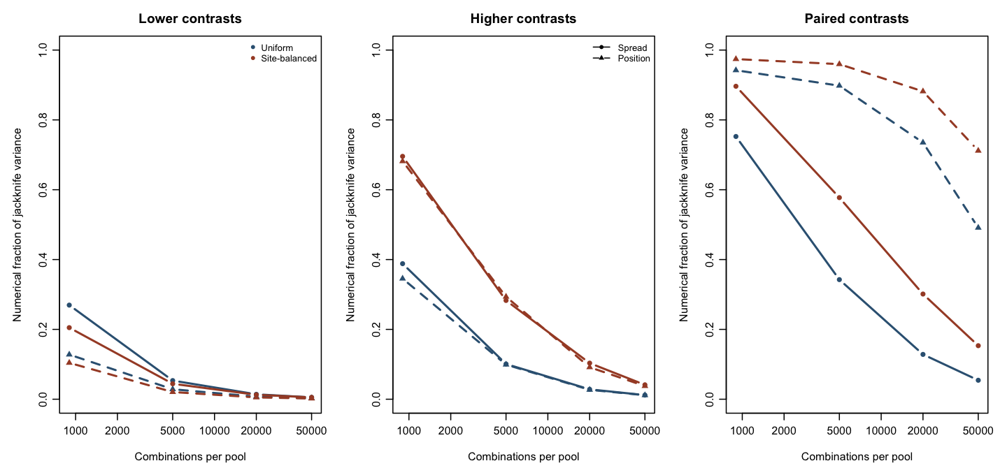
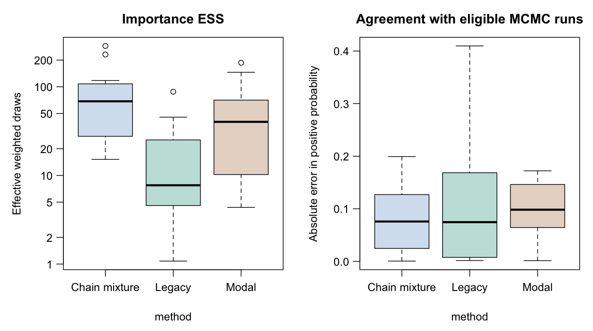

# Phase 5 refinement validation

The [adaptive regularisation and Bayesian validation](MS_GDUM_ADAPTIVE_VALIDATION.md) extends the model, score and covariance experiments.

The [subsequent MS-GDUM refinement](MS_GDUM_INTERACTION_REFINEMENT.md) evaluates nonlinear position, varying spread, focal-site scores and Bayesian estimating equations.

Phase 5's original nonlinear MS-GDUM remains the reference model. This refinement adds independent-pool site-score diagnostics, curvature-whitened posterior integration and a penalty on the actual curvature of the environmental spline. The existing estimators and model defaults remain available.

## Reproducing the analyses

Run from the repository root after installing this branch. Use the manuscript DD2 input directory for the empirical analyses. The simulations write ignored run files in `docs/phase5_refinement/runs`. The summary script can also rebuild all tables and figures from the [versioned results](phase5_refinement/results).

```sh
R CMD INSTALL .
Rscript docs/phase5_refinement/noise.R 24 weak 16
Rscript docs/phase5_refinement/noise.R 70 null 24
Rscript docs/phase5_refinement/noise.R 70 weak 24
Rscript docs/phase5_refinement/noise.R 150 strong 24
Rscript docs/phase5_refinement/lower_exact.R
Rscript docs/phase5_refinement/kernel_timing.R
for signal in null weak; do
  Rscript docs/phase5_refinement/posterior.R calibration "$signal" 1 16 900,5000
  Rscript docs/phase5_refinement/posterior.R calibration "$signal" 1 8 20000,50000
  Rscript docs/phase5_refinement/posterior.R reference "$signal" 1 4 900,5000
  Rscript docs/phase5_refinement/posterior.R mixture "$signal" 1 4 900,5000
done
Rscript docs/phase5_refinement/posterior.R long_reference null 3 3 900
Rscript docs/phase5_refinement/posterior.R long_reference weak 1 1 900
for n in 70 150; do Rscript docs/phase5_refinement/curvature.R "$n"; done
for i in 1 2; do Rscript docs/phase5_refinement/equal_cpu.R "$i"; done
for i in 1 3 4; do Rscript docs/phase5_refinement/empirical.R "$DD2" "$i"; done
Rscript docs/phase5_refinement/empirical.R "$DD2" 1 20000
Rscript docs/phase5_refinement/empirical.R "$DD2" 3 20000
Rscript docs/phase5_refinement/empirical.R "$DD2" 4 16000
Rscript docs/phase5_refinement/summarise.R
```

Independent commands can run in parallel. Use separate `CALIBRATION_CPP_CACHE` directories when compiling the simulation helper concurrently. Timing was measured on macOS arm64 with R 4.6.1. The numerical tests check exact curvature and its null space, raw weighted and complete conditional score identities, centred covariance algebra, certified hull support, and agreement of importance sampling and independent chains on a seeded joint example.

## Set integration and ecological uncertainty

Let $V_1,V_2$ be separately centred site pseudovalues from independent set pools of equal size on the same observed sites. The numerical covariance diagnostic is
$$
\widehat\Sigma_{\mathrm{MC}} = (V_1-V_2)^T(V_1-V_2)/[2n(n-1)].
$$
The expected covariance of the difference, conditional on the sites, cancels the common site signal and doubles the variance if both pools have the same distribution. This compares numerical variance with the average of the two ordinary jackknife covariance estimates. A large ratio identifies an unreliable ecological variance estimate at the tested integration budget. A single diagonal ratio can exceed one when the two estimated site patterns have negative sample cross-products. The pooled pseudovalue covariance uses the actual averaged vectors. We apply no automatic subtraction to estimate ecological variance.

The simulation repeated fixed generating null and weak effects at $n=70$, weak effects at $n=24$, and strong effects at $n=150$. There were 24 repeated site samples per scenario except 16 for the small exhaustive experiment. Each data set used two independent coupled pools of 900, 5,000, 20,000 and 50,000 sets per order. The score model has three regular unrestricted coefficients per order. The lower order is two and the higher orders are four, eight or sixteen. At $n=24$, complete enumeration at both orders gives the finite-community estimator and exact matched deletions. At $n=70$ and $n=150$ all 2,415 and 11,175 pairs respectively give complete lower-order references. Higher-order fits at those sizes remain incomplete.

| $n=70$, weak effects, uniform paths | Numerical fraction at 900 | At 5,000 | At 20,000 | At 50,000 |
|---|---:|---:|---:|---:|
| Lower spread | .270 | .053 | .014 | .005 |
| Lower position | .128 | .029 | .007 | .003 |
| Higher spread | .388 | .101 | .028 | .012 |
| Higher position | .345 | .099 | .027 | .011 |
| Paired spread change | .752 | .343 | .128 | .054 |
| Paired position change | .942 | .898 | .735 | .491 |

The numerical component explains much of the very wide intervals at 900 combinations. With $n=150$ and strong generating effects, the higher-order numerical share fell from .746/.759 for spread/position to .052/.049 at 50,000. The paired position change still had a .650 numerical share at 50,000. The paired contrast subtracts strongly correlated ecological site effects, leaving a small ecological variance against which ordinary integration errors can dominate.

For $n=70$, weak effects and uniform paths, centred parameter-bootstrap coverage for nominal 50% intervals went from .625/.688/.854 at 900 sets to .542/.521/.604 at 50,000, in lower/higher/paired order respectively. Nominal 95% coverage changed from .896/.979/1.000 to .917/.896/.958. At $n=150$ with strong effects the 50% coverages fell from .667/.896/.938 to .542/.604/.646. Averaging two 50,000-set pseudovalue pools brought the last three rates to .542/.542/.521. Each layer contains its spread and position effects. The tables preserve the separate effects, interval levels and sampling scenarios. Results from 24 ecological samples are descriptive and can vary considerably.

The complete $n=24$ paired reference still covered .688 of generating changes at nominal 50% with the parameter bootstrap. At 900 uniform combinations the corresponding rate was .906. Exact integration improved agreement without eliminating all conservatism in that small scenario. For complete $n=70$ weak-effect pairs, 50% coverage was .417 for spread and .708 for position. Low-budget integration does not explain every difference from nominal coverage.



Centring deletion-ratio scores changes their site average but leaves the centred covariance unchanged. At $n=70$ and 900 uniform sets, the median numerical fraction for the lower-position score was .138 for deletion ratios and .136 for analytical inclusion weights. It was .108 for conditional inclusion ratios centred and scaled by the exact complete-set identity. At 50,000, the methods were almost indistinguishable for the levels. For paired position, the conditional version reduced the score fraction from .339 to .326. Two-pool averaging reduces the numerical component under the independence assumptions. It cannot restore precision when contrast-specific integration error is still large. At equal counts, site balance improved the lower-order scores but worsened many higher and paired scores. Cyclic windows balance individual appearances while adjacent windows reuse most of their sites. This dependence can increase the variability of higher-order set kernels.

## Equal-CPU comparison

Two 30-site ecological communities used exhaustive order-three and order-four references and 32 fresh samples per sampler. Set generation, proposal weights, paired designs, fitting and score evaluation were all timed. We used pilot CPU measurements to choose comparable counts and recorded actual costs independently.

| Higher-order sharing bound | Coupled sampler | Median CPU (ms) | Spread-change RMSE | Position-change RMSE | Median relative site-score error |
|---|---|---:|---:|---:|---:|
| .319–.339 | Uniform | 45.5 | .111 | .117 | .589 |
| .319–.339 | Site-balanced | 44.5 | .119 | .107 | .447 |
| .319–.339 | Species-informed | 46.5 | .104 | .109 | .648 |
| .640–1.000 | Uniform | 48.5 | .035 | .034 | .620 |
| .640–1.000 | Site-balanced | 48.5 | .032 | .025 | .455 |
| .640–1.000 | Species-informed | 53.0 | .039 | .030 | .751 |

Here site balance improved the paired conditional-score estimates at similar times. The site-balanced design gave slightly higher spread-change error in the lower-sharing case. Species-informed sampling improved spread-change error in that case despite fitting fewer sets, while its site-score estimates were noisier in both. Fitted effect contrasts and deletion-based uncertainty can favour different samplers.

## Integrated curvature regularisation

For a fitted environmental curve $f(z)=\sum_j\beta_j B_j(z)$, the penalty is $\beta^T C\beta$, with $C_{jl}=\int B_j''(z)B_l''(z)\,dz$ over the stored standardised site range. The calculation evaluates the actual degree-two I-spline derivatives. Their second derivatives are linear on each knot interval and a two-node Gaussian rule integrates the quadratic products exactly. Numerical tests verify the derivative integral, PSD and that the null function is linear on the interval. The original non-negative spread constraints remain in place. The penalty's null space is established from the derivatives rather than from assumed equalities among the coefficients.

The comparison used 24 site samples per cell, $n=70,150$, two orders, 2,400 combinations, two predictors, and controlled linear, nonlinear and collinear nonlinear generating effects. The curvature strength was .008 in the average fractional-logit loss, with ridge .0001 in the ridge and combined fits. The adjacent coefficient penalty of .001 remains a comparator. Uncertainty here is repeated-sample variability of the ecological estimands. Each relative Shapley target was calculated from the conditional mean without site noise on an independent 14,000-set reference. The meaning of that target is conditional on the simulated community.

| Generating case | Model | Integrated spread RMSE | Position RMSE | Relative position allocation RMSE |
|---|---|---:|---:|---:|
| Linear | Original A | .0155 | .0526 | .1710 |
| Linear | Curvature | .0093 | .0407 | .1276 |
| Linear | Reduced B | .0097 | .0369 | .0804 |
| Nonlinear | Original A | .0155 | .0455 | .0835 |
| Nonlinear | Curvature | .0158 | .0439 | .0922 |
| Nonlinear | Ridge | .0155 | .0445 | .0838 |
| Nonlinear | Reduced B | .0172 | .0418 | .2283 |
| Collinear nonlinear | Original A | .0329 | .2614 | .0858 |
| Collinear nonlinear | Curvature | .0337 | .2630 | .0897 |
| Collinear nonlinear | Ridge | .0329 | .2181 | .0850 |
| Collinear nonlinear | Combined | .0343 | .2197 | .0895 |

Curvature increased stability for the generating linear effect, where suppressing nonlinear variation matches the underlying ecology. In the nonlinear case it reduced the SD of integrated spread error from .0140 to .0106 and increased negative bias from −.0068 to −.0118. The combined result therefore had nearly the same RMSE as the original. The ridge term stabilised collinear position because it penalises position amplitude. Curvature acts on spread and had little effect on that problem. The reduced model's relative allocation was especially biased under nonlinear spread. Retain A as primary and use the curvature and ridge models as sensitivities with their effect biases reported explicitly.

## Joint Bayesian jackknife empirical likelihood

The refinement evaluates the same six-dimensional joint posterior as a function of spread, position and intercept at each order. It solves for a regular score-based centre, estimates the posterior mode and local Hessian on a whitened scale, and uses a defensive Student-$t$ mixture. A pilot adapts the mixture and is discarded before evaluating two independent importance batches. An alternative pilot learns mixture centres from short chains. Independent reference chains adapt only during warmup and retain draws under a frozen proposal. All these integrations use the same prior and likelihood within a comparison. The two-pool calculation changes the estimated moment functions and is assessed separately.

A native score kernel accelerates repeated evaluation while preserving the exact importance-weighted score, including Horvitz–Thompson scaling. Median two-order evaluation times in milliseconds were 1.80 to .14 at 900 combinations and 102.02 to 7.86 at 50,000, with agreement to numerical tolerance. This speeds likelihood evaluation. The diagnostics below assess the accuracy of integrating that likelihood.

For each simulation, 1,100 final proposals were assessed against ESS of at least 120 overall and 60 per batch, a converged mode with unclipped posterior curvature, and separate batch agreement for the mean and probabilities above zero and .10. The tolerances were .20 posterior SD for the mean and .10 absolute probability. These are numerical screening criteria. Reference chains required split $\widehat R\leq1.05$ and autocorrelation ESS of at least 200 for all six parameters and all six contrasts.

| Combinations per order | Modal adaptive median ESS, null / weak | Two-pool conditional median ESS, null / weak | Modal adaptive full passes, null / weak |
|---:|---:|---:|---:|
| 900 | 15.9 / 15.2 | 19.2 / 20.7 | 0/16 / 0/16 |
| 5,000 | 29.1 / 34.7 | 9.8 / 10.0 | 0/16 / 0/16 |
| 20,000 | 25.4 / 26.1 | — | 0/8 / 0/8 |
| 50,000 | 26.4 / 34.6 | 2.3 / 6.8 | 0/8 / 0/8 |

Improving site-set integration alone did not resolve posterior integration. Two-pool conditional scores often made the posterior numerically harder to integrate even though they reduced the site-score approximation errors in the separate covariance experiment. In the matched 900-set reference experiment, median legacy ESS out of 1,200 draws was 26.0 under the null and 10.4 with weak effects. With 2,800 final proposals and adaptive modal whitening, the corresponding medians were 65.1 and 46.9. Learning the mixture from short chains gave ESS between 15 and 289 and passed all six checks in one of sixteen runs. Cost and stability both varied substantially.

Certified hull exclusions were rare in the modal adaptive calibration. At 50,000, there were 22 under the null and 16 under weak effects, each out of 8,800 final proposals. The solver returned 22 and 17 uncertified failures, respectively, and zero rank failures. The density concentrated well inside the region of regular empirical-likelihood evaluations. In a separate stress test an intercept shift created seven certified ordinary hull exclusions. Adding the artificial score $-(\log n)\bar J/2$ restored finite likelihood in all seven, with weights .292–.303 on the artificial score. These large weights show how much the adjustment can change inference at a poorly supported parameter. We use it as an explicit sensitivity for diagnosed hull problems. The small failure rate in the calibration supplies little reason to use it there. [Cheng & Zhao (2019)](https://doi.org/10.1093/biomet/asz031)

All sixteen independent short reference runs failed the joint MCMC check. Increasing retained draws from 3,200 to 32,000 in each of four chains yielded usable 900-set references for two selected cases. The minimum ESS was 387 under the null and 552 with weak effects, with maximum split $\widehat R$ of 1.020 and 1.011. Each took about 70 CPU seconds. These two references audit integration on the same fixed data and set pool. They give no estimate of ecological coverage.

| Weak signal, 900 sets | Maximum error in $P(\mathrm{effect}>0)$, lower / higher / paired | Maximum mean error in posterior SD, lower / higher / paired | Maximum 95% endpoint error in posterior SD, lower / higher / paired |
|---|---:|---:|---:|
| Legacy importance | .008 / .400 / .410 | .445 / .598 / .533 | .690 / 2.072 / 2.184 |
| Modal adaptive | .007 / .158 / .136 | .710 / .081 / .032 | .423 / 1.663 / 1.912 |
| Short-chain mixture | .015 / .199 / .155 | .082 / .224 / .227 | .367 / .903 / .879 |

The short-chain mixture in the weak case passed its internal batch checks, yet differed from long MCMC by as much as .205 in $P(\mathrm{effect}>.10)$ at the higher order and .120 for a paired change. The two batches can miss the same region of posterior mass. In the null comparison, the short-chain mixture's maximum errors in positive probability were .026/.079/.092, with endpoint errors of .469/1.042/1.244 posterior SD. The two examples show that local curvature and a modest mixture can improve portions of the posterior while undersampling tails or joint directions relevant to higher-order and paired inference.

Across the ecological calibration replicates, only four effect-specific intervals passed the internal check, all from one null data set at 900. The lower level had two passes, the higher level had one and the paired change had one. Independent checks revealed that even a full internal pass can miss relevant posterior mass. The current results cannot establish JEL coverage or power separately at lower and higher orders or for changes. The remaining uncertainty includes the calibration of the underlying empirical likelihood for paired MS-GDUM scores, particularly when orders increase and coefficients are constrained. Keep refined JEL experimental and the pseudovalue method as a comparator.



## Selected full nonlinear empirical refits

The same relative-abundance responses, constant working weights, common site-based basis and predictors used in Phase 5 were fitted at two orders per community. Each independent reference used matched site deletions across orders. The point-budget pilot estimated contrast-specific Monte Carlo variance and selected the sampler. An independent check at each reference budget assessed the three contrasts at each level and their three changes. Absolute tolerances were .015 for spread and .030 for position. The archived budget results include the relative Shapley allocation and its separate declared tolerance. The previous Phase 5 ecological diagnostic found appreciable variation at the higher order of each community.

| Community, orders | Higher sharing estimate / response SD | Initial sets and fresh point checks | Larger sets and fresh point checks | Higher spread / position numerical fraction at larger budget | Paired spread / position numerical fraction at larger budget |
|---|---:|---:|---:|---:|---:|
| Finnish birds, 15 and 28 | .788 / .0269 | 4,000 and 6/9 | 20,000 and 7/9 | .282 / .500 | .392 / .916 |
| Forest Hemiptera, 6 and 11 | .334 / .0216 | 4,400 and 8/9 | 20,000 and 9/9 | undefined / .242 | .138 / .567 |
| Arctic plants, 4 and 7 | .813 / .0235 | 9,617 and 9/9 | 16,000 and 9/9 | .114 / .055 | .166 / .140 |

For Finnish birds, higher and paired spread still exceeded the .015 point tolerance, with independent upper SD bounds .0180 and .0182. The higher-order position estimate was .0676 with pooled site SE .0311, while the change was −.0017 with pooled SE .0219. The paired position covariance remained strongly pool-dependent despite passing the point check. For Forest Hemiptera, the larger run moved the paired position across the point threshold and reduced the numerical fraction from 1.034 to .567. The estimate was −.0573 with pooled SE .0317. At order 11 the spread effect was on its lower boundary in every deletion, producing zero estimated pseudovalue variance and an undefined numerical fraction. This boundary diagnostic needs a separate inferential analysis. For Arctic plants both budgets passed every point check. At the larger budget, paired spread, position and relative position Shapley changes were −.0095, .0041 and .0879, with pooled SEs .0257, .0619 and .1252, respectively. Even with smaller numerical fractions, these site data leave the paired changes imprecise.

At the largest budgets the smallest raw exclusion counts were 17,550, 18,409 and 14,328 in the same community order. Substantial deletion support can coexist with Monte Carlo error when the estimated change combines two similar effects. Recommend reporting independent-pool covariance checks for the declared level and paired contrasts alongside point verification. For these examples, the higher-order and paired findings warrant different limits within each community. The selected pairs alone do not establish each community's highest informative order.

## Implications and unresolved issues

- Incomplete integration explains much of the low-budget conservatism in the jackknife and pseudovalue bootstrap. For example, nominal 50% jackknife coverage under weak effects at 70 sites was .625/.667/.854 at 900 and .562/.562/.667 at 50,000 for lower, higher and paired effects. The complete small-community reference still showed some conservatism. The high numerical fractions for some paired effects require a contrast-specific precision check even at 50,000.
- Keep the original nonlinear model primary. Integrated curvature stabilised nearly linear effects in the simulations, with bias when true spread was nonlinear. Ridge helped with collinear position. Both can be used in a sensitivity analysis.
- Evaluate conventional, site-balanced and species-informed paths with an independent equal-cost pilot for the intended point contrast and its site score. Better balance improved some score-variance estimates but its dependent windows had larger higher-order errors in other cases.
- Better integration resolved two fixed-posterior comparisons and exposed errors in the earlier importance results. Reliable JEL calibration across independent ecological samples remains unresolved.
- Keep the matched site jackknife as comparison and retain the existing uncertainty defaults. Use the centred pseudovalue bootstrap as a sensitivity after the independent-pool check. A small ecological SE estimated under noisy deletions is insufficient to choose a definitive combination budget.
- The empirical reruns cover the three priority communities at selected pairs and a single response. They support narrower claims about the tested level and difference contrasts. Evidence for broader manuscript conclusions and a calibrated procedure for constrained boundary effects remains open.

Source package verification used `R CMD check` with status OK and 1,394 passing package test expectations, one pre-existing CRAN skip, zero errors and zero warnings.
