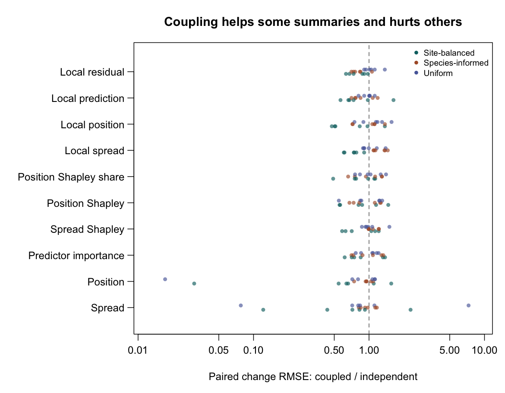
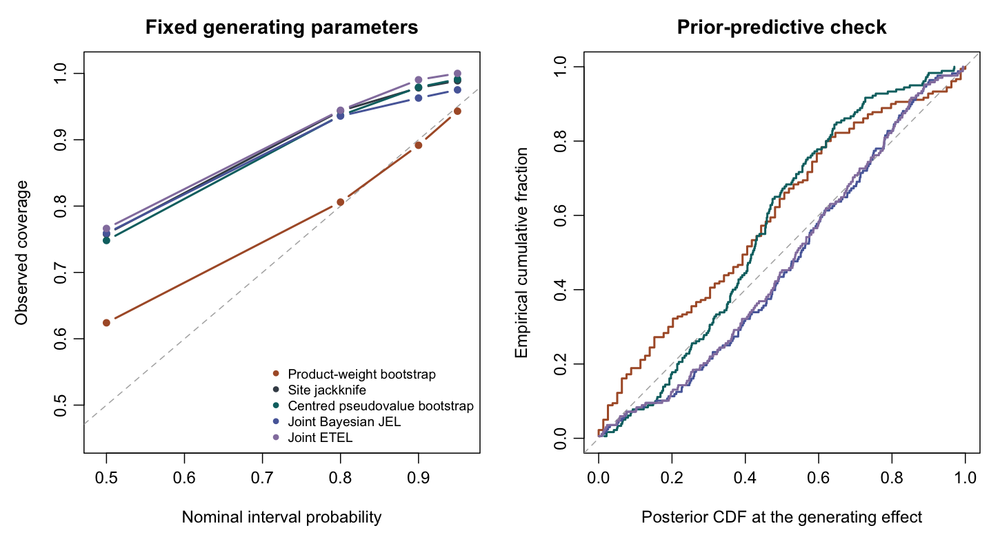
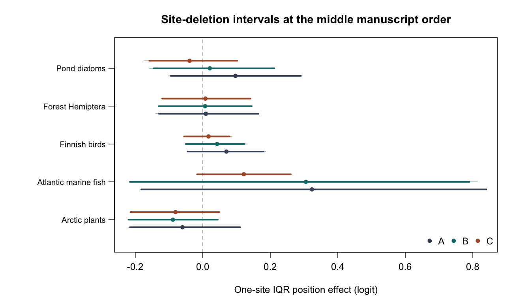

# Phase 5 validation report

## Decisions

Keep the existing MS-GDUM and its defaults. The reduced linear-spread model is a useful comparator and often reduces numerical conditioning problems, but changed spread bias when the generating effect was nonlinear. Coupled sampling reduced error for some across-order summaries and increased it for others. Select the sampler with an independent pilot for the declared contrasts. The centred pseudovalue bootstrap is a computationally inexpensive uncertainty sensitivity analysis. The joint empirical-likelihood posterior showed uneven interval calibration, low importance ESS and limited power for paired changes. These results do not support adopting it as the primary inferential method.

The detailed derivations are in [PHASE5_MATHEMATICS.md](PHASE5_MATHEMATICS.md). All changes concern the existing MS-GDUM framework. The manuscript is untouched.

For a new study, generate the paths with `sample_sets_coupled()` and pass both the community and the fixed environmental reference to `ugdm_path_data()`. Use its paired response vectors and proposal ratios for every candidate fit. `ugdm_model_design()` constructs the matching design for A, B or C. Declare the contrasts and absolute numerical tolerances before running `ugdm_contrast_budget()`, then report the three limits with `ugdm_order_status()`. Each row can pass independently. Use the matched site rows and common Dirichlet weights when bootstrapping effect changes or Shapley differences.

For a low-dimensional, regular unrestricted JEL analysis, supply both orders to one `ugdm_jel()` call. A probability for a practical positive position change is the sum of its normalised weights on rows with $\lambda_{\mathrm{mean},k}-\lambda_{\mathrm{mean},j}>\delta$. Retain the joint draw rows, use coefficient names to select the two orders, and examine the effective importance sample size before interpreting that probability.

## Reproducing the validation

Install the package from this branch and run from the repository root. The empirical scripts use the five existing DD2 datasets and the preprocessing from the manuscript-scale studies. Supply the directory containing those DD2 tables as `DD2`. Site-level output uses row numbers and omits coordinates.

```sh
R CMD INSTALL .
for i in 1 2 3; do Rscript docs/phase5/coupling.R "$i"; done
Rscript docs/phase5/equal_time.R
for n in 70 100 150 250; do
  Rscript docs/phase5/generating_effects.R "$n" 24
  for signal in null weak strong; do
    Rscript docs/phase5/calibration.R "$n" "$signal" 30
  done
done
Rscript docs/phase5/calibration.R 100 spatial 30
Rscript docs/phase5/calibration.R 100 prior 30
Rscript docs/phase5/calibration.R 100 weak 12 1200
Rscript docs/phase5/boundary.R
Rscript docs/phase5/retention_stress.R
for i in 1 2 3 4 5; do
  Rscript docs/phase5/empirical.R "$DD2" "$i"
  Rscript docs/phase5/empirical_limits.R "$DD2" "$i"
done
Rscript docs/phase5/summarise.R
```

Run scripts write ignored shards under `docs/phase5/runs`. The summary script assembles the [versioned compressed replicate data, summary tables and figures](phase5/results). It can also regenerate summaries from the shipped compressed files. The runtime was R 4.6.1 on macOS arm64. Clocks in the sampler and point-fit benchmarks are process CPU time. JEL timing is elapsed time from the posterior function; the timing comparison is descriptive.

The mathematical tests verify coupled marginal frequencies, exact raw importance ratios, weighted expectations, cyclic balance, and the incremental design versus the original incidence, abundance and predictor evaluators. They check original model predictions, the sum/mean position mapping, exact site-score identities, the Dirichlet covariance formula, and the EL and ETEL constraints. A joint JEL test checks aligned posterior dimensions, weighted normalisation and refusal to apply the zero-score method to a constrained fit. The full source-package `R CMD check` completed with **Status OK**.

## Coupling and numerical budgets

The sampler study used counts from three simulated communities with $n=14,70,150$, differing occupancy, abundance and niche breadth, both normalised incidence and relative abundance, and 24 independent runs per combination of sampler, coupling and budget. The small study uses exhaustive order-three and order-five references. The larger studies use 40,000-set reference fits, which still have Monte Carlo error. Every comparison uses model B, geographic distance, a common fixed environmental basis and matched working weights. Local errors compare predictions and response-scale allocations for the first site, as a numerical test of the LCZD summaries.

At 2,400 combinations, median coupled-to-independent across-order RMSE ratios over sampler families, communities and both responses were .842 for spread, .943 for position, .973 for importance, .995 for absolute spread Shapley, .865 for absolute position Shapley and .979 for the relative position allocation. Ratios varied substantially. Local prediction had a median of .876, while the median ratios for local spread and position were .953 and 1.019. Observed spread ratios ranged from .078 to 7.279. Small independent errors, sparse sharing and occasional unstable reference contrasts make ratios sensitive at the extremes. Individual-order errors, variances, reference estimates and CPU times are available in the replicate table.

At 8,000 combinations, median CPU times for incremental versus standalone calculation of both responses and all design blocks were 44 versus 65 ms at $n=14$, 103 versus 147 ms at $n=70$, and 80 versus 132 ms at $n=150$. These timings isolate set-level evaluation. They exclude fitting and shared proposal construction.



A matched-CPU sensitivity used the sparse $n=70$ community. At order eight the exact sharing probability was bounded between .001760 and .001851, and expected shared relative abundance was $5.94\times10^{-5}$. The experiment targeted a common median CPU time using independently measured pilot costs, then reran each sampler with 24 fresh draws. Actual medians were 75–81 ms. Coupled species-informed sampling used 2,127 sets and had spread/position change RMSEs .108/.113, compared with .191/.128 for independent species-informed sampling at 1,208 sets. Independent uniform sampling used 2,400 sets and had .700/.602 errors. Independent site-balanced sampling occasionally produced extreme slopes and had much larger errors in this cell. At 600 sets at most two thirds of random uniform replicates yielded a usable across-order spread change, and constant-response fits were excluded from error summaries. It would be misleading to infer improved ecological estimability from any sampler here. With such rare sharing, 2,400 uniform combinations contain only about four positive-sharing sets on average.

The adaptive pilot included set construction, model fitting, allocations and the local summaries. At $n=150$, coupled uniform sampling confirmed four absolute-tolerance targets, including the spread change at 1,740 and position change at 500 combinations. The order-level spread and position candidates were confirmed at 2,529 and 500 combinations respectively. At $n=70$, even the selected coupled species proposal predicted 199,535–365,152 sets before the confirmation margin and exceeded the study's 15,000-set ceiling for all four contrasts. That is a computational outcome for this pilot, with weak ecological support documented separately. The numbers are study-specific budgets.

The 250-site rare-core boundary simulation from Phase 4 also ran through the reduced-model pipeline. At order 30 both retention ratios were .900, although expected shared richness was .0525 and mean shared relative abundance was only $5.25\times10^{-9}$. The sampled relative-response SD was $2.12\times10^{-8}$. At the all-sites order the response was constant and the working information had rank one of three. Convergence flags on such data do not provide ecological support.

## Recovering known generating effects

The controlled fractional-logit simulations generated responses using a specified conditional mean and independent bounded site-level noise shared across sets. They used 24 ecological draws at each of 70, 100, 150 and 250 sites, orders three and approximately .11 of site count, two environmental predictors, and 2,100 coupled combinations. Cases include null, weak and strong linear effects, nonlinear spread, and a highly collinear nonlinear case. The nonlinear truth lies in A's spline basis. The empirical count simulations above have known niche mechanisms and finite-community fitted references only.

| Generating case | Model | Integrated spread RMSE | One-site position RMSE | Median scaled information condition |
|---|---|---:|---:|---:|
| Strong linear | A | .0155 | .0457 | 1,205 |
| Strong linear | B | .0118 | .0284 | 81 |
| Strong linear | C | .0126 | .0333 | 1,188 |
| Nonlinear | A | .0161 | .0406 | 1,188 |
| Nonlinear | B | .0177 | .0301 | 115 |
| Nonlinear | C | .0183 | .0341 | 1,185 |
| Collinear nonlinear | A | .0341 | .2181 | 36,032 |
| Collinear nonlinear | B | .0370 | .2158 | 1,492 |
| Collinear nonlinear | C | .0347 | .1739 | 35,982 |

In the collinear case, smoothness alone gave position RMSE .2159, similar to B. The ridge-plus-smoothness fit reduced that error to .1739 under the strengths used here. For the nonlinear case the spread bias was −.0057 for A, −.0116 for B and −.0134 for C. The improved condition of B did not resolve all of the collinear-position uncertainty. Models A and B in this table are unpenalised. C uses smoothness .001 and ridge .0001 on the average working loss. Results support maintaining B as a simpler sensitivity model, and comparing C on ecological contrasts as well as prediction error.

## Site-based Bayesian calibration

The regular joint calibration uses six generating coefficients from two orders of the unconstrained linear-spread model, with 900 coupled sets per order. Four site counts and three fixed signal levels use 30 independent ecological draws per cell, or 360 draws in total. Seeds recur across signal scenarios to pair the comparison. Conditional Poisson uses 79 refits and common site weights across orders. The matched jackknife uses actual delete-one-site refits. Both pseudovalue variants use 700 Dirichlet draws. Ordinary JEL uses 150 importance proposals with a Gaussian prior of SD 2. ETEL and the stronger Gaussian prior of SD .5 were assessed at 100 sites. Coverage is calculated among available intervals. Rows are pooled over four level and two paired-change effects. The two ETEL and SD .5 comparisons have narrower study grids.

| Uncertainty estimator | Available fixed-parameter intervals | 50% coverage | 80% coverage | 90% coverage | 95% coverage |
|---|---:|---:|---:|---:|---:|
| Conditional Poisson | 100% | 62.4% | 80.6% | 89.2% | 94.3% |
| Matched site jackknife | 100% | 75.8% | 94.4% | 97.8% | 98.9% |
| Centred pseudovalue bootstrap | 100% | 74.8% | 93.7% | 97.9% | 99.1% |
| Raw pseudovalue bootstrap | 100% | 73.8% | 93.6% | 97.8% | 98.8% |
| Joint Bayesian JEL | 97.2% | 75.9% | 93.6% | 96.3% | 97.5% |
| Joint ETEL, 100 sites | 96.7% | 76.6% | 94.4% | 99.0% | 100% |
| Joint Bayesian JEL, SD .5, 100 sites | 96.7% | 60.6% | 89.7% | 98.3% | 99.7% |

For a predeclared probability-of-positive rule of .95, conditional Poisson made positive level decisions in 8.3% of null cases and 89.4% of strong positive level cases. The corresponding pairs were 1.0%/68.3% for centred pseudovalues and 1.5%/48.9% for ordinary JEL. The comparable one-sided jackknife rule gave 1.0%/66.7%. For the strong positive position **change** alone, power was 100% for conditional Poisson, 31.7% for centred pseudovalues and 5.1% for JEL among available posteriors. These case-specific outcomes show both the cost of overcoverage and possible differences between levels and changes. Probability above the predeclared threshold .1, posterior and point biases, and results by contrast are reported in the data tables. The stronger Gaussian prior moved the strong position-change posterior mean towards zero, with bias −.193 in that 100-site study.

Ten of the 360 ordinary-JEL fixed-parameter cases did not return a posterior. The median importance ESS was about 24 out of 150 proposals across the JEL studies. Among successfully reported runs, invalid proposal fractions were at most 0.7%. Rejection statistics on successful runs do not include whole-dataset failure. At 100 sites, increasing to 1,200 proposals in 12 of the weak-effect replicates raised median JEL ESS from 34 to 40 and changed mean probability of positive effects from .707 to .670 across the six contrasts. The median JEL elapsed time was .38 s at the smaller proposal count. By comparison, the median CPU cost of centred pseudovalue draws including prior matched deletion fits was .019 s, and product-weight resampling was .199 s. This sensitivity suggests substantial importance concentration and does not isolate posterior calibration from numerical integration error.

The spatial stress test used correlated site noise and an environmental gradient related to site coordinates. Pooled 95% coverage fell to 78.9% for conditional Poisson, 87.8% for site jackknife, 87.2% for centred pseudovalues and 92.0% for JEL among valid runs. There was no justified spatial block design for the existing sites in this phase. The separate $n=100$ prior-predictive experiment drew coefficients from the same Gaussian SD .35 prior used by JEL and then simulated conditional-mean responses. JEL had 95.8% coverage in 30 data draws, but the pooled posterior CDF curve is not exactly uniform. Its six contrasts share each dataset. This check uses the controlled fractional-response data generator and does not establish prior-predictive calibration for measured ecological communities.



A separate monotonicity stress test at 100 sites made the lower-order spread coefficient exactly zero. The constrained fit hit that boundary in 44.4% of replicates. The untruncated centred pseudovalue draws had 20.8% negative spread draws at that order on average. Approximate 95% coverage was 97.2% for pseudovalues and 100% for site-jackknife intervals, in 36 runs. These draws demonstrate boundary leakage and are not a constrained posterior. The package rejects direct zero-score JEL for constrained fits.

## The five empirical communities

The full point grid uses every environmental variable and geographic distance in the existing data tables, both normalised incidence and relative abundance with constant weights, the three manuscript orders, two budgets of 1,500 and 5,000, both independently drawn and coupled uniform sets, and all three model variants. This gives 360 point fits. The comparison uses fixed predictor bases and units. At 5,000 coupled combinations, median scaled condition numbers across the two responses and three orders were 117,060 for A, 33,050 for B and 117,946 for C. All these fits converged numerically. Numerical convergence by itself does not certify estimability.

The matched uncertainty study uses the lowest and middle manuscript orders at 2,000 combinations. It performs all site deletion fits for A, B and C, and computes within- and between-order contrasts using 799 aligned Dirichlet vectors. Bayesian bootstrap comparisons use 39 conditional Poisson refits for B. It returned 516 of 540 possible effect/order/model/response intervals. Other intervals had incomplete deletion or undefined relative-Shapley outputs. The full models exceed the dimension or constraint scope of the JEL experiment. Their Bayesian probabilities here are pseudovalue-bootstrap approximations.

| Community | Middle order | Relative-abundance position share, A / B / C | Pseudovalue probability position allocation exceeds spread, A / B / C |
|---|---:|---:|---:|
| Finnish birds | 15 | .337 / .406 / .390 | .013 / — / .058 |
| Pond diatoms | 8 | .300 / .336 / .353 | .039 / .126 / .153 |
| Forest Hemiptera | 6 | .494 / .505 / .503 | .637 / .805 / .775 |
| Arctic plants | 4 | .702 / .869 / .746 | .877 / .920 / .887 |
| Atlantic marine fish | 8 | .323 / .330 / .416 | .175 / .232 / .293 |

Point shares use the 5,000-set reference and probability estimates use the 2,000-set deletion analysis. The forest Hemiptera point allocations were near equal under all three models. For pond diatoms the focal pH position effect changed from .154 under A to −.015 under C, in one-site interquartile logit units at order eight. The allocation evidence and the focal gradient effect describe different estimands. The figure compares 95% site-jackknife intervals (thin) and centred pseudovalue intervals (thick).



The empirical LCZD output includes 13,752 site/order/response/model rows with fitted baseline, spread, position and residual. The maximum absolute reconstruction error for observed dissimilarity was $1.7\times10^{-15}$. Across the relative-abundance fits, observed-minus-predicted site residuals ranged from −.147 to .219. Observed-configuration examples record one-site replacement, replacement of the entire pair and the nearest observed mean-position match subject to a spread difference. The latter may still move position and other environmental variables, so the table includes the actual shift. Residual distinctiveness describes omitted or imperfectly modelled variation in these fits.

The separate order-limit illustration uses full model B. It distinguishes response support (declared SD thresholds .005 for incidence and .002 for abundance), matched deletion stability in two 3,500-set reference pools, and independent budget confirmation. It reports relative allocation and paired levels individually. Under that policy the Arctic-plant incidence order-two spread, position and relative allocation all passed, and the abundance order-two spread and position passed. Pond-diatom incidence position passed at order eight while its other contrasts remained unresolved. Across the ten community-by-response studies, 35 of 60 numerical targets passed. Only six of the broader 120 per-effect rows passed all axes. Fourteen were computationally unresolved following adequate ecological and deletion diagnostics, 97 were statistically unresolved, and three marine-fish relative-abundance rows were ecologically uninformative under the declared SD tolerance. Highest manuscript orders without matched deletion certification remain unresolved unless the response support check itself fails. The associated table includes exact sharing moments, bounds, abundance zeta, effective contributing species and the retention breakpoint from the same communities. Potential site dependence is an additional limit on classical inferential calibration.

## What remains unresolved

- Joint score EL at higher dimension or larger $k/n$ needs a validated limiting argument and better posterior integration. This study does not establish valid boundary-constrained empirical-likelihood inference. ETEL does not resolve that gap.
- The empirical matched deletion fits at 2,000 combinations demonstrate sensitivity to model variants. More independent integration and spatial resampling work is needed before treating those probabilities as manuscript evidence.
- The sampler decision is contrast-specific. Cases with rare sharing can have severe numerical instability even when site paths, their weights and incremental calculations are mathematically correct.
- The five empirical communities illustrate how to report separate ecological, statistical and computational limits. The numerical thresholds in this report should be justified for each scientific question before an order decision is used substantively.
