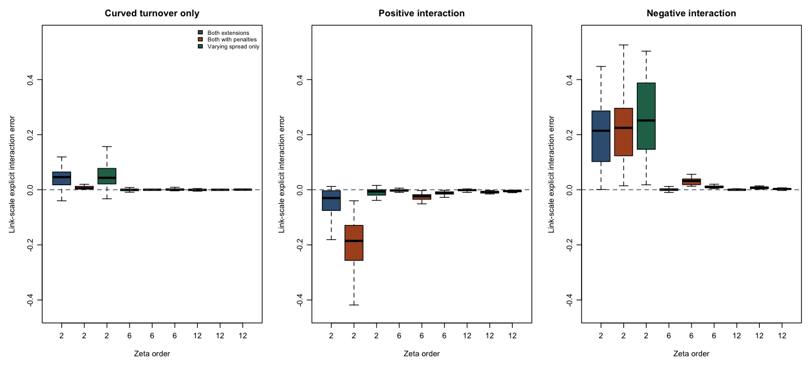

# Extended MS-GDUM model validation

The original MS-GDUM remains the reference. The extensions use its fractional-logit objective, directional I-spline design, optional geographic component and constrained optimiser. All four fitted forms are nested through zero nonlinear position coefficients, equal spread endpoint coefficients, or both.

## Design and penalties

On the stored training range, let $t=(z-c)/h$, where $c$ is the midpoint and $h$ is the half-range in standardised units. The position curve has basis $z,t^2,t^3$, with an intercept shared by the model. The model averages these features over the sites in each set. Its nonlinear part can increase, decrease, or have an interior minimum or maximum. The spline has one cubic segment and linear continuation at either boundary, with continuous value and first derivative. The quadratic and cubic features can produce nonlinear site averages with the same set mean. In particular, $\overline{z^2}=\bar z^2+\operatorname{var}_k(z)$, where the denominator is $k$. This gives nonlinear position a direct within-set dispersion component and complicates mechanistic interpretation. Discrepancies between fitted directional and position effects can also reflect the geometry of the dissimilarity response and its relation to site-level composition. [Warton, Wright & Wang (2012)](https://doi.org/10.1111/j.2041-210X.2011.00127.x)

For one predictor the spread design stacks $D_b(1-u)$ and $D_bu$, where $u=(\bar z-L)/(U-L)$ is clamped to $[0,1]$ under the training bounds. Nonnegative endpoint coefficients ensure a nondecreasing curve at fixed $u$ through nonnegative interpolation of the two directional curves. Moving sites may change both set mean and spread simultaneously. Monotonicity under such a joint move does not follow from the endpoint constraints. The link contribution splits at the centre of the range into $D^\top(\beta_L+\beta_U)/2$ and $(u-.5)D^\top(\beta_U-\beta_L)$. [Hastie & Tibshirani (1993)](https://doi.org/10.1111/j.2517-6161.1993.tb01939.x)

A weighted sum of four quadratic forms penalises integrated directional curvature (average of the endpoint penalties when varying), local position curvature, the squared coefficient distance between endpoints, and slope magnitude. The two nonlinear position entries have curvature weights $8/h^3$ and $24/h^3$. These follow by integrating the squared second derivatives of $t^2$ and $t^3$. Their cross-product integrates to zero by symmetry. The original linear slope has zero curvature. Site-block tuning compares a declared grid with common combination draws across penalty candidates. Each fold estimates predictor scales and spline bounds only from its training sites. Spatial designs retain contiguous spatial blocks, and each block contributes equally to the validation loss. Fold omission measures selection stability. Its variation does not give a confidence interval. The multiple quadratic penalties use ideas from shape-constrained smoothing and adaptive shrinkage. This procedure avoids using the sampled set count as an independent-observation count for smoothness selection. [Pya & Wood (2015)](https://doi.org/10.1007/s11222-013-9448-7) · [Marra & Wood (2011)](https://doi.org/10.1016/j.csda.2011.02.004)

## Aliasing and contrasts

For monotone quadratic $f(z)=az+bz^2$, the directional term for a pair is $|z_i-z_j|(a+2bm_{ij})$. At order two, $m_{ij}=\bar z$ and an explicit linear modification of linear spread can be exactly reproduced by the existing quadratic turnover. At larger orders, the difference is proportional to $\operatorname{mean}_{i<j}\{|z_i-z_j|(m_{ij}-\bar z)\}$, which need not vanish. The unweighted mean of pair midpoints is $\bar z$. Weighting by pair spread changes this identity. Full-rank information at larger orders resolves exact aliasing on the fitted design but still permits strong overlap. The diagnostics report unpenalised information rank and condition, estimated boundary coefficients and residual variation left in position and varying-spread features after accounting for the additive design.

Use comparable environmental configurations drawn from the observed design. The simulations chose nearest sets to a two-by-two grid of 30th and 70th percentiles of mean position and within-set spread, using standardised coordinates and up to 30 unique sets per grid cell. The maximum mean distance from observed sets to one of these targets is recorded. Compute one contrast of predictions on the link scale and one contrast after applying the inverse logit. A link contrast can reflect additive nonlinear spread even when the explicit interaction is zero. A response-scale contrast can also reflect the nonlinear inverse link. The separately reported explicit-interaction contrast uses the endpoint-difference component alone.

Hierarchical deviance attribution first refits the additive submodel on the same sets with equal endpoint curves. Its two main effects receive the ordinary two-component Shapley allocations. The increment from the additive fit to the full varying fit is reported separately. This increment can be negative under penalised fitting because the objective used for fitting contains penalties and the reported deviance excludes them.

## Reproduction and design

From the repository root after installing the package:

```sh
Rscript docs/interaction_refinement/model_validation.R recovery 24
Rscript docs/interaction_refinement/model_validation.R allocation 12
Rscript docs/interaction_refinement/model_validation.R curves 12
Rscript docs/interaction_refinement/summarise_models.R
```

The recovery simulation uses 70 sites or 100 for the spatial setting, orders 2, 6 and 12, 2,400 training sets and up to 1,500 sets on held-out sites. The nine scenarios cover the original linear position and turnover, nonlinear position with linear spread, nonlinear directional turnover without explicit interaction, positive and negative interactions, two nearly collinear predictors, spatially autocorrelated site effects, and species niche processes with narrow and wide environmental optima profiles. Model-matched simulation responses use a known conditional mean and shared site-level contamination. The generating linear directional term is explicitly recovered from the stored I-spline basis and verified by its numerical residual rather than inferred from equality of coefficients. The species niche simulations use relative-abundance dissimilarity with unit working weights. Their known data-generating process operates at site and species level, so no particular joint GDUM coefficient is taken as truth.

The independent set-pool experiment uses three pools per budget of 1,000 or 6,000 per order across 12 site samples and three scenarios. Ordered prefixes pair the draws across orders. Both orders use the same fixed observed site data within a replicate. These comparisons measure Monte Carlo uncertainty of point contrasts, distinct from uncertainty due to independent site sampling or inference for site scores.

## Numerical results

### Position and spread separation

All 216 unpenalised joint fits at order two were rank deficient. The selected joint fits at orders six and twelve were full rank, but working-condition numbers for curved turnover without interaction were roughly 22,062 and 131,734. Under high predictor collinearity these medians reached 2.31 million and 15.29 million. Those are diagnostics for the actual weighted set designs. Well-predicted dissimilarities can coexist with ambiguity about how the model allocates their variation.

In the nonlinear-position scenario, the nonlinear-position-only fit reduced error in the standard deviation of the position component over held-out sets at every order. Its response prediction improvements were smaller.

| Order | Position component SD RMSE, original | Position component SD RMSE, nonlinear position | Held-out dissimilarity RMSE, original | Held-out dissimilarity RMSE, nonlinear position |
|---|---:|---:|---:|---:|
| 2 | .1603 | .0666 | .0525 | .0477 |
| 6 | .0876 | .0415 | .0309 | .0293 |
| 12 | .0497 | .0308 | .0211 | .0209 |

### Explicit interaction

In the curved-turnover-only scenario, the unpenalised joint model produced an absolute explicit link contrast above .05 at order two in 11 of 24 samples. It exceeded that descriptive threshold in zero samples at orders six and twelve. This is an observed false attribution rate at a declared effect threshold, without a significance test. At order six the unpenalised model recovered both genuine interaction directions with low error. Combined shrinkage largely suppressed explicit interactions in those same scenarios.

| Scenario, order 6 | Explicit link contrast RMSE, original | Joint, unpenalised | Joint, combined penalties | Held-out dissimilarity RMSE, original / joint |
|---|---:|---:|---:|---:|
| Curved turnover only | .0000 | .0057 | .0002 | .0282 / .0285 |
| Positive interaction | .0295 | .0063 | .0291 | .0324 / .0284 |
| Negative interaction | .0361 | .0079 | .0362 | .0379 / .0324 |

The explicit contrast in the original model is structurally zero. For the benchmark two-by-two configurations, the absolute true contrast typically shrank as order increased because supported combinations occupy a narrower joint set of mean positions and dispersions. Interpretation at high order requires the size of the supported ecological contrast as well as its direction. The niche results provide a complementary check with a known species-level process. The unpenalised joint fit produced absolute explicit link contrasts above .05 in 20/24 narrow-niche samples and 9/24 wide-niche samples at order six. Its median incremental interaction deviance explained was .0045 and .0176, respectively. These patterns arise from the dissimilarity response to species niches and have no predefined generating coefficient.



### Curve profiles on common predictor support

A separate run assessed centred link-scale curves in 12 samples per case at 51 common climate values spanning the empirical 10th to 90th percentiles. The outputs compare the midpoint directional curve, local position curve and the difference between directional endpoint curves. Endpoints are coefficient-derived summaries and can be weakly identified when observed set means fall mostly in the centre of the training range.

| Scenario, order 6 | Model | Median directional curve RMSE | Median position curve RMSE | Median endpoint difference RMSE |
|---|---|---:|---:|---:|
| Nonlinear position | Original | .1611 | .1028 | .0000 |
| Nonlinear position | Nonlinear position only | .0192 | .0430 | .0000 |
| Curved turnover only | Joint, unpenalised | .0257 | .0680 | .1007 |
| Curved turnover only | Joint, combined penalties | .1451 | .1062 | .0033 |
| Positive interaction | Joint, unpenalised | .0167 | .0499 | .0588 |
| Positive interaction | Joint, combined penalties | .2380 | .3730 | .7546 |
| Negative interaction | Joint, unpenalised | .0180 | .0441 | .0531 |
| Negative interaction | Joint, combined penalties | .2547 | .1101 | .7912 |

The full nonlinear model recovers the two curves and endpoint difference under the tested genuine interactions at order six. The same endpoint flexibility creates false structure under curved turnover alone, even though the observed-configuration contrast may be small. A shrinkage combination that removes that structure can also erase genuine interactions or distort the main curves. The original model and separately penalised components therefore provide important comparisons on supported environmental configurations.

### Smoothing selection and set-pool precision

For the spatial scenario, five contiguous validation blocks selected penalties in eight samples at each of three orders. Only 8/24 selections were unchanged after omitting any one of the five blocks, and the median agreement was four of five. At order six, site-selected held-out response RMSE was .0185 and explicit interaction RMSE was .0088, compared with .0179 and .0049 under the unpenalised joint fit over the full 24 samples. Among the same eight samples, the unpenalised RMSEs were .0171 and .0050. Selection varies by block and its effect on the ecological estimates warrants separate reporting from predictive validation.

For the positive interaction scenario and the combined-penalty model, increasing the budget from 1,000 to 6,000 reduced median point contrast variability across independent set pools:

| Contrast | Link-scale SD at 1,000 | Link-scale SD at 6,000 |
|---|---:|---:|
| Order 2 | .00491 | .00177 |
| Order 6 | .00060 | .00034 |
| Change 2 to 6 | .00526 | .00143 |
| Change 6 to 12 | .00074 | .00041 |

These SDs quantify numerical integration conditional on the sites and fitted penalty. A stable estimate can still be biased toward zero. Joint support, conditional contrast identifiability and site-level uncertainty remain necessary before interpreting a varying-spread term.

[Recovery summaries](results/model_recovery_summary.csv) · [Block tuning results](results/model_smoothing_selection.csv) · [Curve profiles](results/model_curve_recovery_summary.csv) · [Set-pool precision](results/model_pool_precision_summary.csv)
